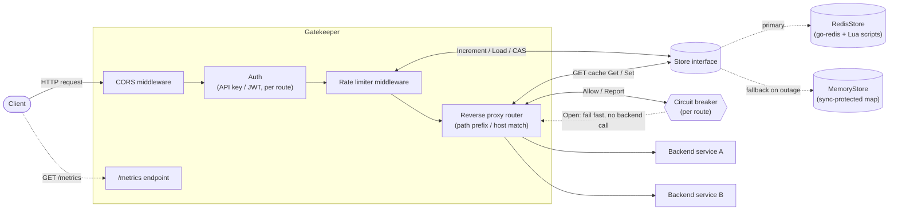
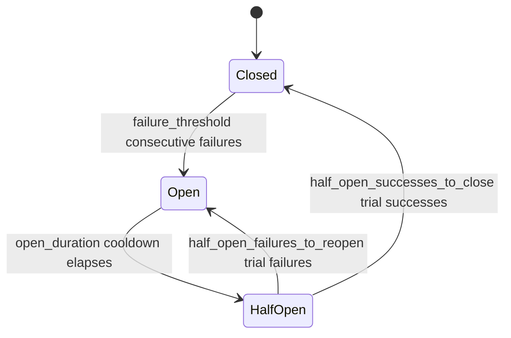

<p align="center">
  
</p>

# Gatekeeper

[](https://github.com/Deipedra34/Gatekeeper/actions/workflows/ci.yml)
[](https://github.com/Deipedra34/Gatekeeper/releases/latest)
[](go.mod)
[](LICENSE)

Gatekeeper is a rate limiter and API gateway written in Go. It sits in front of your backend services, decides which requests get through based on per-client limits, and proxies the rest to wherever they're supposed to go. Metrics and graceful degradation come standard, not bolted on afterward.

I built it as a reference implementation more than a one-off tool. All three rate-limiting algorithms you'd actually reach for in production — Token Bucket, Sliding Window Log, Fixed Window Counter — run against the same storage abstraction, so switching one for another (or memory for Redis) is a config change, not a rewrite.

## Features

- **Three pluggable rate-limiting algorithms.** Token Bucket, Sliding Window Log, Fixed Window Counter, selectable via config, all built on one `Store` interface.
- **Two storage backends.** An in-memory map for single-instance deployments, or Redis when you need limits coordinated across a fleet.
- **Reverse proxy core.** Routes requests to backend services by path prefix or hostname, using `net/http/httputil.ReverseProxy` under the hood.
- **Configurable backend timeout and retry.** Every backend attempt is bounded by a per-attempt timeout; a timeout, connection failure, or 5xx response is retried with exponential backoff and jitter, up to a configurable limit. 4xx responses are never retried.
- **A normal middleware chain.** Rate limiting, request logging, API key / JWT auth, and CORS, composed the same way you'd compose any `net/http` middleware.
- **API keys and JWTs, per route.** Each route requires an API key, a JWT (HS256 or RS256), or either one. Existing configs keep plain API key auth without any changes.
- **Per-client tiers.** Limits scoped by API key, source IP, a custom header, or a JWT claim, with independent free/premium/whatever tiers defined in config (or picked by a JWT claim).
- **A Prometheus-compatible `/metrics` endpoint.** Requests allowed/rejected per client and tier, current limiter state, request latency histograms, cache hits/misses per route, circuit breaker state and rejections per route, auth successes/failures by method.
- **Response caching for GET requests.** Backend responses are cached per route in the same storage backend the rate limiter uses (memory or Redis), with a configurable TTL, an opt-out per route, and a header to bypass the cache for debugging.
- **A circuit breaker around every backend call.** Closed / Open / Half-Open, configurable per route, so a struggling backend gets a break from traffic instead of every request queuing up behind retries and timeouts.
- **WebSocket proxying.** `Upgrade: websocket` requests are routed like any other request and pass through CORS, auth, and the rate limiter (one token per connection attempt). After that, frames are relayed transparently in both directions. Per-route idle timeouts, connection caps per route and per client, `Origin` allow-lists, metrics, and graceful close on shutdown are all included.
- **TLS and mTLS.** An optional HTTPS listener with TLS 1.2+ by default, hot-reloaded certificates (on `SIGHUP` or file change), client certificate verification, an `mtls` route auth mode with certificate-based client identity and tiers, HSTS, an HTTP→HTTPS redirect, and TLS / mTLS to backends.
- **Distributed tracing.** Optional OpenTelemetry traces with a span per pipeline stage and per backend attempt (retries are visible), W3C `traceparent` / `baggage` propagation in and out, OTLP gRPC/HTTP export, parent-based sampling, trace IDs in log lines and an optional response header. Secrets never reach spans, and a dead collector never slows a request.
- **Request and response transformation.** Per route, a request can have its prefix stripped, its path rewritten with a regex, and headers and query parameters added, set, or removed. Responses can have headers changed, plus optional security headers. Values use a small whitelist of variables (`${client_id}`, `${request_id}`, ...) that can't leak credentials. There are request IDs, forwarding headers set from the real connection, and cache keys that follow the forwarded request.
- **Load balancing and health checks.** A route can spread traffic over several backends with round robin, weighted round robin, least connections, random, or sticky IP / header hashing. Active and passive health checks take failing backends out of rotation and bring them back. Circuit breakers are per backend, retries fail over to a different backend, and backends removed by a reload drain gracefully. A single `target` still works exactly as before.
- **Dynamic config reload.** `SIGHUP` re-reads the config file and swaps routes, rate-limit rules, tiers, and algorithm into the running gateway atomically — no restart, no dropped requests. An invalid config is logged and ignored, leaving the old one in place.
- **Authenticated admin API.** Optional, on its own listener (never the proxy port). It shows status, redacted config, routes, backend health, per-client rate limit state, and cache stats. It can reload the config, purge the cache, reset rate limits, drain and re-enable backends, and reset circuit breakers. Bearer tokens are stored as SHA-256 hashes; mTLS, a CIDR allowlist, failed-login lockout, a JSON audit log, tracing, and metrics are all included.
- **IP access control and auto-ban.** Optional allow and deny lists of IPv4/IPv6 addresses and CIDR ranges, global and per route, checked first so a blocked address costs one lookup and no rate limit tokens. The client address comes from the connection, and `X-Forwarded-For` is believed only from configured trusted proxies. Addresses that keep hitting the rate limiter, failing auth, or getting denied are banned for a while, with escalating bans for repeat offenders, shared across instances through Redis. There are metrics, rate-limited logs, and admin endpoints to list, ban, and unban.
- **Traffic splitting for canary and A/B releases.** Optional per-route variants, each with its own load-balanced backend group, split by weight. Clients stay on their variant through a stable hash of their IP, API key, JWT subject, or certificate, or a signed cookie. Allowlisted testers can force a variant with a header, match rules pin requests by header, cookie, or path, and a rollout raises a canary's weight in steps. Guardrails roll a variant back automatically when its 5xx rate or p95 latency gets worse than the baseline's, with a minimum sample and a cooldown. Per-variant metrics, log fields, span attributes, Grafana panels, and admin endpoints to set weights, pause, resume, promote, and roll back.
- **Fault injection for resilience testing.** Optional per-route rules delay, abort, or reset a percentage of requests, targeted by header, path, method, variant, backend, or client allowlist. Faults go through the same retries, circuit breakers, and health checks a real failure would. A global kill switch, automatic expiry, startup and reload warnings, an "active" gauge, and a guard against 100% aborts in production keep it from causing harm. Includes metrics, log fields, span attributes, Grafana panels, and admin endpoints to add and remove rules at runtime.
- **OpenAPI request validation.** Optional per-route checks against an OpenAPI 3.x spec (YAML or JSON) with [kin-openapi](https://github.com/getkin/kin-openapi): the operation, path, query, and header parameters, and the JSON body, with types, required fields, enums, formats, bounds, and patterns. `enforce` mode answers invalid requests with a 400 (or 422) listing which fields failed, never echoing values, before they reach the cache, circuit breaker, or backend. `report_only` logs and counts them and forwards them anyway. Paths are matched after `strip_prefix` and `rewrite`, bodies are read within a size limit and restored intact, and nesting depth and validation time are bounded. Credentials are left to auth. Specs reload with the config, and an invalid one keeps the old. Includes metrics, a span attribute, rate-limited logs, Grafana panels, and an admin endpoint.
- **Graceful degradation.** If Redis goes down — at startup or mid-run — Gatekeeper falls back to in-memory limiting and logs a warning instead of taking the gateway down with it.

## Installation

Every [GitHub Release](https://github.com/Deipedra34/Gatekeeper/releases) has prebuilt binaries for Linux, macOS, and Windows on amd64 and arm64, plus a SHA256 checksums file, and a multi-arch Docker image is published to GitHub Container Registry. To build from source instead, see [Setup](#setup).

### Prebuilt binaries

Archives are named `gatekeeper_<version>_<os>_<arch>.tar.gz` (`.zip` on Windows), where `<os>` is `linux`, `darwin`, or `windows` and `<arch>` is `amd64` or `arm64`. Each one contains the `gatekeeper` binary, this README, the LICENSE, and the example [`configs/config.yaml`](configs/config.yaml).

Linux / macOS:

```bash
VERSION=2.5.0
OS=linux     # or darwin
ARCH=amd64   # or arm64
BASE="https://github.com/Deipedra34/Gatekeeper/releases/download/v${VERSION}"

curl -LO "${BASE}/gatekeeper_${VERSION}_${OS}_${ARCH}.tar.gz"
curl -LO "${BASE}/gatekeeper_${VERSION}_checksums.txt"
sha256sum --ignore-missing -c "gatekeeper_${VERSION}_checksums.txt"   # macOS: shasum -a 256 --ignore-missing -c ...

tar xzf "gatekeeper_${VERSION}_${OS}_${ARCH}.tar.gz"
./gatekeeper -version
./gatekeeper -config configs/config.yaml
```

The macOS binaries aren't notarized. If you downloaded one with a browser rather than `curl`, clear the quarantine flag first: `xattr -d com.apple.quarantine ./gatekeeper`.

Windows (PowerShell):

```powershell
$Version = "2.5.0"
$Zip = "gatekeeper_${Version}_windows_amd64.zip"   # or windows_arm64
$Base = "https://github.com/Deipedra34/Gatekeeper/releases/download/v$Version"

Invoke-WebRequest "$Base/$Zip" -OutFile $Zip
Invoke-WebRequest "$Base/gatekeeper_${Version}_checksums.txt" -OutFile checksums.txt
$Expected = (Select-String checksums.txt -Pattern " $Zip" -SimpleMatch).Line.Split(" ")[0]
if ((Get-FileHash $Zip -Algorithm SHA256).Hash -eq $Expected) { "checksum OK" } else { throw "checksum MISMATCH" }

Expand-Archive $Zip -DestinationPath gatekeeper
cd gatekeeper
.\gatekeeper.exe -config configs\config.yaml
```

`gatekeeper -version` prints what you're running:

```
gatekeeper 2.5.0
commit: 0e34e8b5781eeaf1099bd8102835049698741049
built: 2026-10-27T12:00:00Z
go: go1.26.5 linux/amd64
```

A local `go build` reports `dev` / `none` / `unknown` instead.

To try the example config without any real services, also download `gatekeeper-mockbackend_<version>_<os>_<arch>` from the same release. It's the stand-in backend from the [Docker Compose stack](#run-the-full-stack-with-docker-compose). Run `./mockbackend` next to the gateway: it listens on `:9000`, where the example config's catch-all `/` route points, so `curl -i http://localhost:8080/api/ping -H "X-API-Key: demo-free-key"` goes all the way through.

### Docker image

Images are published for `linux/amd64` and `linux/arm64`, tagged with the release version and `latest`:

```bash
docker pull ghcr.io/deipedra34/gatekeeper:latest     # or a specific version, e.g. :2.5.0
docker run --rm ghcr.io/deipedra34/gatekeeper:latest -version
docker run --rm -p 8080:8080 ghcr.io/deipedra34/gatekeeper:latest
```

The image runs the example `configs/config.yaml` by default. Mounting your own config works the same as for a locally built image; see [Run with Docker](#run-with-docker).

## Architecture



Every request runs through the same chain: CORS, then auth (API key or JWT, depending on the route), then the rate limiter, then the proxy. The limiter and the proxy don't know about each other — the limiter just needs a client key and a `Store`, the proxy just needs a routing table — so you can test, swap, or reason about either one on its own.

### Package layout

```
cmd/gatekeeper/        entrypoint: wires storage + metrics, runs the server, handles signals
internal/gateway/      assembles the request pipeline from config; rebuilds and swaps it on SIGHUP
internal/config/       YAML config loading, defaults, and validation
internal/ratelimiter/  the three algorithms + the Store abstraction they share
  └─ store/            MemoryStore, RedisStore, and FallbackStore (Redis → memory failover)
internal/transform/    per-route request/response transformation: prefix stripping, regex rewrites, header and query changes, ${...} variables, forwarding headers
internal/proxy/        the reverse-proxy router (path prefix / hostname matching), backend timeout + retry/backoff, GET response caching, circuit breaker integration
internal/cache/        the response cache: key derivation, Cache-Control handling, Store-backed get/set
internal/circuitbreaker/ the Closed/Open/Half-Open state machine wrapped around each route's backend calls
internal/server/       the listeners: plain HTTP or HTTPS (mTLS, certificate hot reload, HSTS), plus the HTTP→HTTPS redirect
internal/lb/           load balancing: backend pools, strategies, consistent hashing, active/passive health checks, draining
internal/split/        traffic splitting: stable hashing, sticky assignment, overrides and rules, rollouts, auto-rollback guardrails
internal/fault/        fault injection: rules, targeting, percentages, exemptions, expiry, and the registry the router asks per request
internal/validation/   OpenAPI request validation: spec loading, operation matching, parameter and body checks (kin-openapi), body limits, error bodies, counts
internal/admin/        the admin API: its own listener, token/mTLS auth, audit log, and the status/config/backends/cache/ratelimit endpoints
internal/tracing/      OpenTelemetry setup (exporters, sampling, OTEL_* overrides), the server span, and span/propagation helpers
internal/certgen/      throwaway CA / server / client certificate generation for tests and scripts/gencerts
internal/websocket/    WebSocket upgrade detection, the frame relay, and the hub tracking open connections (limits, idle timeout, shutdown)
  └─ wstest/           a minimal WebSocket client/server used by tests and scripts/wsclient
internal/middleware/   logging, CORS, API key + JWT auth, rate-limit middleware
internal/metrics/      Prometheus collectors + /metrics handler
configs/                example config.yaml
examples/openapi/      an example OpenAPI spec, validated by the docker-compose demo
scripts/loadtest/      goroutine-based load generator (see "Load testing" below)
scripts/wsclient/      tiny WebSocket client for trying out WebSocket proxying
observability/         OpenTelemetry Collector config for docker-compose.tracing.yml
scripts/gencerts/      writes a development CA plus server and client certificates (see "TLS and mTLS")
```

## Rate-limiting algorithms: trade-offs

`ratelimiter.Limiter` has three implementations. All of them read the same two config knobs per tier — `requests_per_second` and `burst` — but they don't interpret those knobs the same way (see the doc comment on `ratelimiter.Rule` if you want the exact mapping).

| Algorithm | How it works | Accuracy | Cost | Trade-off |
|---|---|---|---|---|
| **Token Bucket** | Each client has a bucket of `burst` tokens that refills continuously at `requests_per_second`. Each request costs one token. | Smooth, no boundary weirdness. Bursts up to `burst` go through immediately; the sustained rate converges to whatever you configured. | O(1) storage per client (a float token count plus a timestamp), one optimistic CAS retry loop per request. | The default I'd reach for most of the time. Costs a bit more CPU and storage than Fixed Window because of the CAS loop and float math, but it's rarely the bottleneck. |
| **Sliding Window Log** | Every allowed request's timestamp gets logged. A request is allowed only if fewer than `burst` timestamps are still inside the trailing 1-second window. | Exact. There's no "more correct" than this one — no boundary doubling, ever. | O(`burst`) storage per client (one timestamp per request in the window) and O(`burst`) work per check just to prune the log. | The most precise option, but also the priciest. For high-limit tiers you're storing hundreds of timestamps per client and shipping that blob to Redis on every request. Works best when `burst` stays modest. |
| **Fixed Window Counter** | Time gets sliced into aligned 1-second windows; each client has one counter per window that resets on rollover. | The weakest guarantee of the three: a client can send `burst` requests at the very end of one window and another `burst` right at the start of the next — up to 2x the configured limit in a short span (`TestFixedWindow_BoundaryCanDoubleAllowedRequests` shows exactly this). | By far the cheapest: one atomic `INCR`-style op per request, O(1) storage. | Reach for this when throughput matters more than fairness at the margins — a coarse global ceiling rather than a strict per-client promise. |

All three share the same `Store` interface (`Increment`, `Load`, `CompareAndSwap`), so switching `rate_limit.algorithm` in config is the only thing you need to change to try a different trade-off against the same storage backend.

## Storage backends

- **`memory`** (default) — a `sync.Mutex`-protected map, local to the process. Fastest option, no external dependencies, but each instance enforces its own limit. Fine if you're running one instance, wrong if you're behind a load balancer.
- **`redis`** — counters live in Redis via [go-redis](https://github.com/redis/go-redis), so every instance behind that load balancer enforces one shared limit per client. `Increment` and `CompareAndSwap` are each a single Lua script, so the read-modify-write is atomic as far as Redis is concerned.

### Graceful degradation

When `storage.backend: redis` is set, Gatekeeper wraps the Redis store in a `FallbackStore`:

- At startup it pings Redis. If that fails, it logs a warning and just starts in fallback mode instead of refusing to boot.
- At runtime, any Redis error on a request sends that request (and everything after it) to the in-memory store, with a warning logged once per outage rather than once per request.
- A background check pings Redis every 5 seconds. Once it's back, Gatekeeper logs the recovery and starts using it again.

The trade-off while Redis is down: limits become per-instance instead of fleet-wide, same as if you'd configured `memory` in the first place — until Redis comes back. What doesn't happen is a crash or a gateway that stops responding.

## Backend request timeout and retry

Every request the proxy forwards to a backend is bounded by `proxy.timeout` and, if it fails, retried according to `proxy.retry` — both configurable in `configs/config.yaml`:

```yaml
proxy:
  timeout: 5s          # per-attempt timeout (default: 5s)
  retry:
    max_retries: 3     # additional attempts after the first (default: 3)
    base_backoff: 100ms # delay before the first retry (default: 100ms)
    max_backoff: 2s      # cap on the backoff delay (default: 2s)
```

All four fields are optional; any left unset get the defaults shown above.

- **Timeout** applies per attempt, not to the whole request — a request that ends up retrying 3 times can take up to roughly `4 × timeout` plus backoff delays in the worst case, not just `timeout`.
- **Retries** kick in only for failures a retry can plausibly fix: a timed-out attempt, a connection error (backend down/unreachable), or a `5xx` response. A **`4xx` response is never retried** — it means the backend understood the request and rejected it, and sending the same request again wouldn't change that.
- **Backoff** is exponential with jitter: the delay before retry *n* is `min(base_backoff × 2^(n-1), max_backoff)`, then a random value between 0 and that number is actually used, so many clients retrying at once don't all hit the backend in the same instant.
- The request body is buffered so it can be replayed identically on every retry attempt.
- If every attempt fails, the proxy returns whatever the last attempt produced: the backend's own `5xx` if that's what kept coming back, or a `502 Bad Gateway` if the backend was unreachable.

**Interaction with rate limiting and metrics:** the rate limiter middleware sits in front of the proxy and only ever sees the original incoming request once, so retries against the backend never cost a client extra rate-limit budget — a request that retries twice before succeeding still counts as exactly one allowed request against that client's limit. Retry attempts and final outcomes are tracked as their own metrics, separate from the raw allow/reject counters (see [Metrics](#metrics) below).

## Load balancing

A route can spread its traffic over several backends instead of one `target`. Gatekeeper picks a backend per request, health-checks backends actively and passively, and routes around the ones that are down. It also fails over between them on retry, and drains backends a reload removes. A route with a single `target` is simply a pool of one and behaves exactly as before. See [ADR 6](docs/adr/0006-load-balancing.md) for the design.

```yaml
routes:
  - path_prefix: "/api/orders"
    lb_strategy: least_connections     # default round_robin
    backends:                          # instead of target:
      - target: "http://10.0.0.11:9000"
        weight: 2                      # default 1
      - target: "http://10.0.0.12:9000"
      - target: "https://10.0.0.13:9443"
        backend_tls: { enabled: true, ca_file: "certs/internal-ca.pem" }   # per-backend override
    health_check:                      # active probes; off by default
      enabled: true
      path: /health                    # default /health, appended to each target's base path
      interval: 10s                    # default 10s
      timeout: 2s                      # default 2s (must not exceed interval)
      healthy_threshold: 2             # consecutive passes to come back (default 2)
      unhealthy_threshold: 3           # consecutive failures to leave (default 3)
      expected_status: [200, 204]      # default: any 2xx or 3xx
    passive_health_check:              # on by default with 2+ backends
      consecutive_failures: 5          # default 5
      ejection_duration: 30s           # default 30s
    drain_timeout: 30s                 # default 30s
```

`backend_tls` set on the route applies to every backend. A backend's own `backend_tls` replaces it for that backend. Circuit breaker settings (`circuit_breaker:`) apply to each backend separately.

### Strategies

| `lb_strategy` | Picks | Uses `weight` |
|---|---|---|
| `round_robin` (default) | Each backend in turn | no |
| `weighted_round_robin` | In proportion to weight, interleaved: weights 5:1 give a ratio of 5:1 without five-in-a-row bursts (nginx's smooth algorithm) | yes |
| `least_connections` | The backend with the fewest in-flight requests and WebSocket connections relative to its weight; ties rotate | yes |
| `random` | At random, weighted | yes |
| `ip_hash` | Sticky by client IP: the first `X-Forwarded-For` entry, else the connection address | yes (ring share) |
| `consistent_hash` | Sticky by the `lb_hash_header` value (e.g. `X-User-ID`), falling back to the client IP when the header is missing | yes (ring share) |

**The hash strategies use a consistent hash ring with virtual nodes**, so when a backend leaves rotation only *its* clients move. Everyone else stays put, and its clients return when it does. Stickiness is best-effort: the key comes from the client, so never rely on it for security.

**WebSocket connections are balanced once, at the handshake,** and stay on that backend for their lifetime. While open, they count as an active connection for `least_connections`.

### Health checks and failover

A backend is **in rotation** when it is:
- passing active health checks (if they're enabled),
- not passively ejected, and
- not draining.

Only backends in rotation are picked.

- **Active checks** probe every backend with `GET <target><path>` on `interval`, through the same transport real requests use (so its TLS settings apply). `unhealthy_threshold` consecutive failures take it out; `healthy_threshold` consecutive passes bring it back. Backends start out healthy, so a restart doesn't begin with 503s.
- **Passive checks** watch real traffic. After `consecutive_failures` failed requests in a row (timeouts, connection errors, `5xx`), the backend is ejected for `ejection_duration` and then gets traffic again, without waiting for a probe. They're on by default for routes with two or more backends and off for single-target routes, where there's nowhere else to send the traffic.
- **Circuit breakers are per backend.** One failing backend trips only its own breaker. A backend whose circuit is open is skipped, and its siblings take the traffic.
- **Retries prefer a different backend.** A retry goes to a healthy backend the request hasn't tried yet. It reuses a tried one only when there's nothing else, which is also why single-target routes still retry against their one backend.
- **When no backend is in rotation,** requests fail fast with `503 no healthy backend available` instead of waiting on backends known to be down. If backends are healthy but every one has an open circuit, the answer is the familiar `503 circuit breaker open`.

Rate limiting, auth, and caching sit in front of the pool and work the same as before. The cache is shared by all of a route's backends. Each `backend.attempt` trace span carries a `gatekeeper.backend` attribute naming the backend it went to.

### Config reloads and draining

On `SIGHUP`:
- **Unchanged backends carry over** with their health, circuit breaker state, and in-flight count intact. A backend is identified by its route and target URL. New settings, such as a weight change or updated TLS files, take effect for it once the whole reload has succeeded.
- **New backends join immediately.**
- **Removed backends drain.** They get no new requests, and the requests and WebSocket connections already on them keep running. When the last one finishes, the backend is forgotten. If `drain_timeout` passes first, whatever is still running is cancelled: an HTTP attempt can be retried on a backend that's still in rotation, and WebSockets are closed with `1001`.
- **A reload that fails leaves the live pools untouched.**

### Load balancing metrics

| Metric | Labels | Meaning |
|---|---|---|
| `gatekeeper_backend_up` | `route`, `backend` | 1 healthy, 0 failing checks or ejected |
| `gatekeeper_route_backends_in_rotation` | `route` | Backends currently receiving new traffic (0 means 503s) |
| `gatekeeper_backend_active_connections` | `route`, `backend` | In-flight requests and WebSocket connections |
| `gatekeeper_backend_requests_total` | `route`, `backend`, `outcome` | Attempts per backend; retries count separately |
| `gatekeeper_backend_health_checks_total` | `route`, `backend`, `result` | Active probes |
| `gatekeeper_backend_ejections_total` | `route`, `backend` | Passive ejections |
| `gatekeeper_backend_circuit_breaker_state` | `route`, `backend` | 0 closed, 1 open, 2 half-open |
| `gatekeeper_backend_draining` | `route`, `backend` | 1 while a removed backend drains |

The live-state gauges are computed at scrape time, so a removed backend's gauges disappear once it has drained. Single-target routes keep reporting `gatekeeper_circuit_breaker_state{route}` as before. The Grafana dashboard has a **Load balancing** row for all of the above.

### Demo: kill a backend and watch traffic shift

[`docker-compose.lb.yml`](docker-compose.lb.yml) adds two more mock-backend instances and runs Gatekeeper with [`configs/config.docker.lb.yaml`](configs/config.docker.lb.yaml). In that config, `/api/lb` is balanced over all three with active (2s) and passive health checks. The plain `docker-compose up` is unchanged.

```bash
docker-compose -f docker-compose.yml -f docker-compose.lb.yml up --build
```

Send a dozen requests and count which instance answered each. Every mock-backend response includes `"instance"`:

```bash
for i in $(seq 1 12); do
  curl -s http://localhost:8080/api/lb/hello -H "X-API-Key: demo-premium-key" | grep -o '"instance":"[^"]*"'
done | sort | uniq -c
```

```
      4 "instance":"mock-backend-1"
      4 "instance":"mock-backend-2"
      4 "instance":"mock-backend-3"
```

Now kill one and run the loop again:

```bash
docker-compose -f docker-compose.yml -f docker-compose.lb.yml stop mock-backend-2
```

```
      6 "instance":"mock-backend-1"
      6 "instance":"mock-backend-3"
```

No request fails while this happens. Any request that hits the dead instance is retried on another one, the passive check ejects it after 3 failures, and the active check confirms it's down within two 2-second probes. `curl -s localhost:8080/metrics | grep -E 'backend_up|in_rotation'` shows it: `gatekeeper_backend_up{...mock-backend-2...} 0` and `gatekeeper_route_backends_in_rotation{route="/api/lb"} 2`. Start it again (`... start mock-backend-2`) and it's back in rotation after two passing probes.

Each instance's admin endpoints are published on the host (`9101`, `9102`, `9103`), so you can also make one misbehave without stopping it:

```bash
curl -X POST localhost:9102/_admin/fail             # answer 503 to everything, health checks included
curl -X POST "localhost:9102/_admin/slow?delay=3s"   # answer slowly
curl -X POST localhost:9102/_admin/recover          # back to normal
```

A failing instance is taken out the same way as a dead one. A slow one stays in rotation, but with `lb_strategy: least_connections` it naturally receives fewer requests, because its requests stay in flight longer.

## Circuit breaker

Every route's backend calls go through a circuit breaker with three states. With [several backends](#load-balancing), each backend has its own breaker, so one bad backend never trips the whole route:

- **Closed** — normal operation. Requests go to the backend as usual; failures are counted.
- **Open** — the backend has failed too many times in a row. Every request is **failed fast** with `503 Service Unavailable` — the backend is never contacted at all — until the configured cooldown elapses.
- **Half-Open** — after the cooldown, a limited number of trial requests are let through to check whether the backend has recovered. Everything else still fails fast while a trial is in flight.



**What counts as a failure** is the same definition the retry logic uses: a timed-out attempt, a connection error, or a `5xx` response. A `4xx` response counts as a *success* for the breaker's purposes — the backend answered the request correctly, it just didn't like what the client sent, which says nothing about the backend's health. Any success (including a `4xx`) resets the consecutive-failure count while Closed.

**Configuration** — per route, in `configs/config.yaml`:

```yaml
routes:
  - path_prefix: "/api/users"
    target: "http://localhost:9001"
    circuit_breaker:
      enabled: true                        # default: true
      failure_threshold: 5                 # default: 5 consecutive failures
      open_duration: 30s                   # default: 30s cooldown
      half_open_max_requests: 1            # default: 1 concurrent trial
      half_open_successes_to_close: 1      # default: 1 trial success closes it
      half_open_failures_to_reopen: 1       # default: 1 trial failure reopens it
```

All fields are optional; omitting `circuit_breaker` entirely gives you the defaults shown above. Set `enabled: false` to exempt a route from circuit breaking altogether — for a backend where you'd always rather wait/retry than ever get a fast-fail 503, for instance.

**Interaction with retries.** The breaker is checked before every attempt a request makes, not just once per incoming request — so if a request's first attempt fails and pushes the breaker from Closed to Open, its *own* second attempt (and any further retries) sees the Open circuit and fails fast immediately: **no retry is made into an already-open circuit**. That fail-fast check happens before the retry's backoff delay too, so a circuit that's already open doesn't even pay the backoff wait before giving up. A circuit-open rejection isn't counted as a retry attempt in `gatekeeper_proxy_retries_total`, and it doesn't consume any of `proxy.retry.max_retries` — it's a distinct outcome from a retried-and-failed backend call, tracked in its own metric (see below). Like retries, this all happens below the rate limiter middleware, so a fast-failed request still counts as exactly one allowed request against the client's rate limit, same as any other outcome.

## Response caching

Gatekeeper caches `GET` responses per route, so repeated requests for the same resource are answered directly without touching the backend at all.

**How it's keyed.** A cache entry is keyed on the route, the backend target, the request method, the full URL (path + query string), and a few request headers that can legitimately change the response body for the same URL: `Authorization`, `X-API-Key`, and `Accept`. Two requests only share a cache entry if all of those match — different API keys, different query strings, or a different `Accept` value each get their own entry. Keying on the backend target as well as the route means a `SIGHUP` reload that repoints a route at a different backend can never serve a stale entry cached under the old one.

**What gets cached.** Only `GET` responses with a `200` status. A backend response carrying `Cache-Control: no-store` is never cached, no matter the route's configuration — every request for it reaches the backend. Anything other than `GET` (`POST`, `PUT`, `DELETE`, ...) always goes straight to the backend; caching never applies to it.

**Configuration** — per route, in `configs/config.yaml`:

```yaml
routes:
  - path_prefix: "/api/users"
    target: "http://localhost:9001"
    cache:
      enabled: true   # default: true — set false to opt this route out entirely
      ttl: 30s        # default: 60s
```

Both fields are optional. Omitting `cache` entirely gives you caching enabled with the default 60s TTL; set `enabled: false` for routes that must never be cached (anything with side effects on `GET`, or responses that are personalized in a way the cache key doesn't account for).

**Bypassing the cache.** Send `X-Bypass-Cache` (any non-empty value) on a request to skip the cache entirely for that one request — no read, no write — useful for confirming what the backend itself currently returns without waiting out the TTL or disabling caching for everyone else. Every cacheable response also carries an `X-Cache: HIT` or `X-Cache: MISS` header, so you can tell which path served a given response.

**Storage and graceful degradation.** Cached entries live in the same storage backend configured under `storage:` — the in-memory map, or Redis via the same `FallbackStore` the rate limiter uses. That means a Redis outage degrades caching exactly the way it degrades rate limiting: reads and writes fail open (skip the cache, go to the backend) rather than erroring or crashing the gateway, with a warning logged. A cache hit is served before the request ever reaches the proxy's retry transport, so it never triggers a backend retry and never costs an extra backend call.

**Interaction with rate limiting:** caching sits behind the rate limiter in the middleware chain, so a cached response still consumes the client's rate-limit budget exactly like an uncached one — caching saves the backend a request, not the client their quota.

## WebSocket proxying

Every route proxies WebSocket connections as well as plain HTTP. A request carrying `Connection: Upgrade` and `Upgrade: websocket` is matched to a route with the same hostname / path-prefix rules as any other request, runs through the same middleware chain, and, once the backend accepts the upgrade, gets a two-way tunnel to that backend. Existing configs pick this up with no changes, because `websocket` defaults to `true`.

**Request flow.**

1. **The middleware chain runs first.** CORS, API key / JWT auth (per the route's `auth_mode`), and the rate limiter all see the upgrade request before anything is upgraded. A failed check answers with the usual `401` / `429`, and the backend is never contacted.
2. **Route policy.** The router then checks `websocket`, `ws_allowed_origins`, `ws_max_connections`, and `ws_max_connections_per_client`, and the route's circuit breaker.
3. **Backend handshake.** The handshake is forwarded to the backend unchanged (`Sec-WebSocket-*`, `Origin`, credentials, and so on), with the incoming `Host` kept and the client's address appended to `X-Forwarded-For`, the same as for HTTP routes. If the backend answers `101 Switching Protocols`, the client gets that `101` with the backend's handshake headers, plus the `X-RateLimit-*` and CORS headers the chain added. If the backend answers anything else, that response is passed to the client as-is.
4. **Relay.** Frames are relayed in both directions, byte for byte. Masking, extensions such as `permessage-deflate`, fragmentation, and ping/pong all pass through untouched. The relay reads frame boundaries but never changes frame contents. Knowing the boundaries lets the gateway send its own Close frame between frames when it needs to, without ever splitting a frame.

**How it interacts with the rest of the gateway.**

| Feature | Behaviour for WebSocket |
|---|---|
| Rate limiting | Each connection attempt (handshake) costs one token. Frames never touch the limiter, so a client can send as many messages as it likes over a connection it already has. |
| `proxy.timeout` | Bounds the backend handshake only: dial, upgrade request, and `101` response. It never applies to an established connection. |
| `server.read_timeout` / `write_timeout` | Cleared as soon as the connection is upgraded. A long-lived WebSocket is not killed by the server's HTTP timeouts. |
| Retries | Never. An upgrade request is sent once. A failed handshake goes straight back to the client (`502` if the backend is unreachable, otherwise the backend's own response). |
| Response caching | Never. Upgrade requests skip the cache entirely: no read, no write. |
| Circuit breaker | Counts **handshakes** only. A dial failure, timeout, or `5xx` handshake response is a failure, and a `101` is a success. How long a connection then stays open, and how it ends, is never reported. An open circuit fails new handshakes fast with `503`. Connections that are already open are not affected. |
| Config reload (`SIGHUP`) | Open connections keep running on the settings they were opened with, and still count toward their route's connection limits. New handshakes use the new config. |

**Configuration.** Per route, in `configs/config.yaml`. Every field is optional:

```yaml
routes:
  - path_prefix: "/ws"
    target: "http://localhost:9000"     # http:// or ws:// (https:// or wss:// for TLS backends)
    websocket: true                     # default: true. false = refuse upgrades with 403
    ws_idle_timeout: 5m                 # default: 5m. Close after this long with no frames either way
    ws_max_connections: 1000            # default: 0 (unlimited). Extras get 503
    ws_max_connections_per_client: 10   # default: 0 (unlimited). Extras get 429
    ws_allowed_origins:                 # default: [] (any origin). Others get 403
      - "https://app.example.com"
```

- **`ws_idle_timeout`.** Any frame in either direction counts as activity, including pings and pongs. When a connection goes idle, the gateway sends both sides a Close frame (`1001`, `"idle timeout"`), waits briefly for the closing handshake, then drops the connection. Clients that need longer quiet periods should send pings.
- **`ws_max_connections_per_client`** identifies clients the same way the rate limiter does: by the JWT client claim for JWT-authenticated requests, otherwise by `rate_limit.scope` (API key, IP, or header). Both limits count connections that are currently open, and a slot frees up as soon as a connection closes.
- **`ws_allowed_origins`** is matched case-insensitively against the `Origin` header, and `"*"` allows any origin. A handshake *without* an `Origin` header is allowed: browsers always send one, so a missing `Origin` means a non-browser client, which could send any `Origin` value it wanted anyway. This check protects browser users against cross-site WebSocket hijacking. It is not a substitute for auth.

**Handshake rejections.**

| Status | Cause | `reason` label |
|---|---|---|
| `401` | Missing or invalid API key / JWT | `auth` |
| `429` | Rate limit exceeded | `rate_limit` |
| `403` | `Origin` not in `ws_allowed_origins` | `origin` |
| `403` | `websocket: false` on the route | `disabled` |
| `429` | Client already at `ws_max_connections_per_client` | `max_connections` |
| `503` | Route already at `ws_max_connections` | `max_connections` |
| `503` | Route's circuit breaker is open | `circuit_open` |
| `503` | Gateway is shutting down | `shutting_down` |
| `502` / backend's status | Backend unreachable, or it refused the upgrade | `backend` |

**Closing.** When either side closes normally, the Close frames are relayed and the connection is torn down. When one side disappears *without* a closing handshake, the other side still gets a Close frame instead of a bare TCP reset. A client whose backend vanished gets `1014` (bad gateway). A backend whose client vanished gets `1001` (going away).

**Graceful shutdown.** Once a connection is upgraded, `http.Server.Shutdown` no longer tracks it. On `SIGINT` / `SIGTERM`, Gatekeeper therefore also closes every WebSocket itself:

1. New handshakes are refused with `503`.
2. Every open connection gets a Close frame (`1001`, `"server shutting down"`) on both sides.
3. Connections have until the end of the 10s shutdown window to finish the closing handshake. Anything still open after that is dropped.

**Trying it out.** The mock backend in [`mockbackend/`](mockbackend/) serves a WebSocket echo endpoint at `/ws/echo`, and [`configs/config.docker.yaml`](configs/config.docker.yaml) routes `/ws` to it. Start the stack with `docker-compose up --build`, then use [`websocat`](https://github.com/vi/websocat):

```bash
websocat -H "X-API-Key: demo-free-key" ws://localhost:8080/ws/echo
```

Each line you type is echoed back through the gateway. Without the header, the handshake is refused:

```bash
websocat ws://localhost:8080/ws/echo
# fails: the gateway answers the handshake with 401 Unauthorized
```

If you don't have `websocat`, the repo includes a small Go client, [`scripts/wsclient`](scripts/wsclient/main.go):

```bash
go run ./scripts/wsclient -url ws://localhost:8080/ws/echo -api-key demo-free-key -message hello -message world
```

```
connected (101 Switching Protocols, X-RateLimit-Remaining: 9)
< hello
< world
closed cleanly (1000)
```

You can do the same without Docker: run the mock backend with `cd mockbackend && go run .` (it listens on `:9000`), then run the gateway with the default `configs/config.yaml`, which also routes `/ws` to `localhost:9000`.

> **Browser clients:** the browser `WebSocket` API can't set custom headers, so it can't send `X-API-Key` or `Authorization`. Browser apps on an authenticated route need to get their credential onto the handshake some other way, for example with a same-origin cookie checked by a JWT-issuing proxy in front of Gatekeeper. Alternatively, use a non-browser client.

## Request and response transformation

A route can change the request it forwards to the backend and the response it returns to the client. A route without a `transform` section is forwarded exactly as before.

**Where it runs:**

- **Before:** auth and the rate limiter see the request as the client sent it.
- **After:** everything else uses the transformed request. That covers the response cache key, retries, load balancing, circuit breakers, and WebSocket upgrades.

**Order of steps:**

- **Request:** `strip_prefix` → `rewrite` → query parameters → headers (remove, set, add).
- **Response:** remove → set → add → security headers.

The rationale is in [ADR 0008](docs/adr/0008-request-response-transformation.md).

### Strip a prefix

```yaml
routes:
  - path_prefix: "/api"
    target: "http://users-service:9001"
    transform:
      request:
        strip_prefix: true      # /api/users/42 -> /users/42, /api -> /
```

### Rewrite the path with a regex

```yaml
    transform:
      request:
        rewrite:
          pattern: "^/api/v1/(.*)$"
          replacement: "/v2/$1"                 # /api/v1/orders/7 -> /v2/orders/7
        # Named groups work too:
        # rewrite: {pattern: "^/u/(?P<id>\\d+)$", replacement: "/users/${id}"}
```

**How rewrites behave:**

- The pattern is matched against the path only, never the query string. The query is forwarded unchanged.
- A path that doesn't match is left alone.
- The result is made absolute, and any `..` segments are removed.
- **Rejected at config load:**
  - Invalid patterns.
  - Patterns longer than 1024 characters.
  - Replacements that reference a capture group the pattern doesn't have (Go would silently turn those into empty strings).
  - Replacements containing `?` or `#`. Use `add_query_params` for query parameters.

Patterns are Go [RE2](https://github.com/google/re2/wiki/Syntax) expressions, which match in time linear in the input. There's no backtracking, so a rewrite rule can't be turned into a catastrophic-backtracking denial of service. Backreferences and lookaround aren't available for the same reason.

### Add, set, and remove headers and query parameters

```yaml
    transform:
      request:
        add_headers:    {X-Gateway: "gatekeeper"}          # only if the client didn't send it
        set_headers:    {X-Client-ID: "${client_id}"}      # replaces whatever the client sent
        remove_headers: ["X-Debug", "Cookie"]
        add_query_params:    {source: "gateway"}            # replaces the client's value, too
        remove_query_params: ["debug"]
      response:
        remove_headers: ["Server", "X-Powered-By"]          # don't advertise the backend stack
        set_headers:    {X-Served-By: "gatekeeper"}
        add_headers:    {Cache-Control: "no-store"}         # only if the backend didn't set it
```

Use `set_headers` for anything the backend trusts: with `add_headers`, a client that sends the header itself keeps its own value.

Response transforms apply to every response on the route. That covers backend responses, cached responses, the gateway's own `502`/`503`s, and the `101` of a WebSocket upgrade. A reload takes effect immediately, even for responses already in the cache.

### Variables

Header and query parameter values can use these variables, and only these. Anything else, such as `${header.authorization}` or `${env}`, fails config validation:

| Variable | Value |
|---|---|
| `${client_ip}` | The client's address. It's the peer address unless `trust_forwarded_headers` is on, in which case it's the first `X-Forwarded-For` address. |
| `${request_id}` | The request ID. Needs `transform.request_id.enabled: true`. |
| `${client_id}` | The client as the rate limiter and `/metrics` see it: `key:<fingerprint>` for an API key (never the key itself), `jwt:<id>`, `mtls:<id>`, or the IP or header value. |
| `${client_tier}` | The client's rate limit tier. |
| `${route}` | The route label, meaning its path prefix or host. |
| `${trace_id}` | The trace ID, or empty when tracing is off. |

There is deliberately no way to copy an arbitrary request header into another header. A transform can't forward a client's API key or JWT anywhere the client didn't already send it. Control characters are stripped from variable values, so a value can never split a header.

### Request IDs

```yaml
transform:
  request_id:
    enabled: true            # off by default
    header: X-Request-ID     # default
```

**How request IDs work:**

- **Which ID is used.** The client's ID is kept when it's valid: up to 128 characters from `A-Z a-z 0-9 - _ . : / + = @`. Otherwise, or when there's none, the gateway generates a random UUID.
- **Where it goes.** The ID is forwarded to the backend and returned to the client on every response, including `401` and `429`. If the backend's response has its own value, the gateway's replaces it.
- **Using it in a transform.** It's also available as `${request_id}`, for example `set_headers: {X-Correlation-ID: "${request_id}"}`.

### Forwarding headers

```yaml
transform:
  trust_forwarded_headers: false   # default
```

**With `false` (the default):**

- Client-supplied `X-Forwarded-For`, `X-Forwarded-Host`, `X-Forwarded-Proto`, `X-Forwarded-Port`, `X-Forwarded-Prefix`, `Forwarded`, and `X-Real-IP` are dropped.
- They're set from the connection instead:
  - `X-Forwarded-For` and `X-Real-IP` are the peer address.
  - `X-Forwarded-Proto` is `http` or `https`.
  - `X-Forwarded-Host` is the request's `Host`.
- So a client can't spoof its address to a backend.

**With `true`:** these headers pass through as in earlier versions, with the peer appended to `X-Forwarded-For`. Use this only when Gatekeeper sits behind a proxy you trust to set them.

> **Upgrading:** earlier versions passed client `X-Forwarded-For` through and appended the peer. If Gatekeeper runs behind a load balancer whose `X-Forwarded-For` your backends rely on, set `trust_forwarded_headers: true` to keep that behaviour. This setting doesn't change how `rate_limit.scope: ip` identifies clients.

### Security headers

```yaml
transform:
  security_headers:          # default for every route; off by default
    enabled: true
    content_type_options: nosniff        # X-Content-Type-Options (default)
    frame_options: DENY                  # X-Frame-Options: DENY (default) or SAMEORIGIN
    referrer_policy: no-referrer         # Referrer-Policy (default)

routes:
  - path_prefix: "/embed"
    target: "http://widgets:9000"
    transform:
      response:
        security_headers: {enabled: true, frame_options: SAMEORIGIN}   # override per route
  - path_prefix: "/raw"
    target: "http://files:9000"
    transform:
      response:
        security_headers: {enabled: false}                             # opt this route out
```

They're added only when the response doesn't already have them, so a backend's own value always wins. They apply to responses on matched routes. Responses the gateway answers before routing, such as `401`, `429`, and unmatched paths, don't get them.

### Headers a transform can't touch

These headers are rejected at config load, because another part of the gateway owns them:

- **Both directions:**
  - Hop-by-hop headers (`Connection`, `Keep-Alive`, `Transfer-Encoding`, `Upgrade`, `TE`, `Trailer`, `Proxy-*`).
  - `Content-Length`, `Sec-WebSocket-*`, and the request ID header.
- **Requests:**
  - `Host`.
  - The forwarding headers. These are governed by `trust_forwarded_headers`.
- **Responses:**
  - `Content-Encoding`.
  - `X-RateLimit-Limit`, `X-RateLimit-Remaining`, and `Retry-After`.
  - `X-Cache`, `Strict-Transport-Security`, and the configured `tracing.response_header`.

Hop-by-hop headers are still stripped as before, in both directions, including any header a client or backend names in its `Connection` header. One exception: a header the gateway itself sets is taken off the client's `Connection` list first, so a client can't get it stripped.

### Caching, tracing, and metrics

- **Cache keys** use the forwarded path and query. Two URLs that rewrite to the same backend request share an entry. The key also includes the value of every header the transform sets, so `X-Tenant: ${client_id}` keeps tenants' responses apart. `${request_id}` and `${trace_id}` are left out of the key, so a correlation header doesn't make every request a miss. Using either of them in `add_query_params` on a cached route is rejected for the same reason.
- **Tracing:** when `strip_prefix` or `rewrite` changes the path, the request's span gets `gatekeeper.transform.path` with the forwarded path. The query string is never recorded.
- **Metrics:** `gatekeeper_transforms_applied_total{route, kind}` counts requests a transform changed. `kind` is `path`, `query`, `request_headers`, or `response_headers`. Each request counts once per kind, however many retries it takes.
- **Admin API:** `/admin/v1/config` redacts transform header and query values whose names look like credentials (containing `auth`, `token`, `secret`, `key`, `cookie`, `password`, …). A backend credential set with `set_headers: {Authorization: ...}` is never shown.

## TLS and mTLS

Gatekeeper can serve HTTPS itself, verify client certificates (mutual TLS), authenticate and rate-limit clients by certificate, and talk TLS (including mTLS) to its backends. All of it is off by default. With `tls.enabled: false`, the gateway serves plain HTTP exactly as before, and existing configs need no changes.

### HTTPS listener

```yaml
tls:
  enabled: true
  cert_file: "certs/server.pem"       # PEM certificate, followed by any intermediates
  key_file: "certs/server-key.pem"
  min_version: "1.2"                  # default "1.2"; "1.3" for TLS 1.3 only
  # cipher_suites:                    # optional TLS 1.2 allow-list; default is Go's secure set
  #   - TLS_ECDHE_ECDSA_WITH_AES_128_GCM_SHA256
  #   - TLS_ECDHE_ECDSA_WITH_CHACHA20_POLY1305_SHA256
  redirect_http_port: 8080            # optional plain-HTTP listener that 308-redirects to HTTPS
  hsts:
    enabled: true                     # adds Strict-Transport-Security to HTTPS responses
    max_age: 31536000                 # seconds (default: one year)
    include_subdomains: false
    preload: false
```

`server.listen_addr` becomes the HTTPS address. Everything behind the listener works over TLS unchanged: routes, auth, rate limiting, caching, WebSockets (`wss://`), and `/metrics`. HTTP/2 is negotiated automatically for clients that support it.

**Secure defaults.**
- The minimum version is TLS 1.2, and TLS 1.0/1.1 are refused.
- Cipher suites default to Go's secure list. `cipher_suites` only accepts suites from that list, never the insecure ones. It must include one of the two `AES_128_GCM_SHA256` ECDHE suites, because HTTP/2 requires them.
- TLS 1.3 suites aren't configurable, so `cipher_suites` together with `min_version: "1.3"` is rejected.
- Go picks the cipher suite order itself, taking the hardware into account. The old "prefer server cipher order" option is ignored by Go, so there's nothing to set.

**Contradictory config fails at startup** with a clear error. For example:
- `tls.enabled` without both `cert_file` and `key_file`.
- `client_auth`, `redirect_http_port`, or `hsts` while TLS is off.
- A verifying `client_auth` mode without `client_ca_file`.
- An `mtls` route without client certificate verification.
- A redirect port equal to the HTTPS port.

The certificate, key, and client CA bundle are loaded at startup. A missing, mismatched, expired, or malformed file stops the gateway with an error naming the file. Key and certificate contents are never logged.

**`tls.*` is read at startup only**, like `server.*`, with one exception: the certificate itself.

### Certificate hot reload

The server certificate is served through `tls.Config.GetCertificate`, so it can be replaced without a restart:

- **On `SIGHUP`**, together with the normal config reload. If the reloaded config changes `cert_file` / `key_file`, the new paths are used.
- **When the files change on disk.** Their modification time and size are checked every `tls.reload_interval` (default `30s`). That covers certificate renewers such as cert-manager or certbot hooks.

New handshakes get the new certificate, and connections that are already open keep theirs, so nothing in flight is dropped. A reload that fails keeps the previous certificate in use and logs why. Failures include unreadable files, a key that doesn't match, an expired certificate, or a half-written pair. A half-written pair (new certificate, old key) is retried as soon as the second file changes.

### Client certificates (mTLS)

```yaml
tls:
  client_auth: require_and_verify     # none | request | require | verify_if_given | require_and_verify
  client_ca_file: "certs/ca.pem"      # PEM bundle of CAs client certificates must chain to
```

| `client_auth` | Certificate required? | Verified against `client_ca_file`? | Usable for auth? |
|---|---|---|---|
| `none` (default) | no, and not requested | — | no |
| `request` | no | no | no |
| `require` | yes | no | no |
| `verify_if_given` | no | yes, if one is sent | yes |
| `require_and_verify` | yes | yes | yes |

With `require_and_verify`, a client without a valid certificate never completes the handshake. That covers a client with no certificate, one from an untrusted CA, and one that has expired. `verify_if_given` is the flexible option: clients without a certificate still connect and authenticate some other way, such as an API key, while certificate holders can use `mtls` routes. Only a certificate that `crypto/tls` actually **verified** is ever trusted. A certificate that was merely presented under `request` / `require` never authenticates anyone.

### Auth modes and certificate identity

Routes gain a fourth `auth_mode`, and `either` now accepts certificates too:

| `auth_mode` | Accepts |
|---|---|
| `api_key` (default) | a valid API key, as before |
| `jwt` | a valid JWT, as before |
| `mtls` | a verified client certificate (needs `client_auth: verify_if_given` or `require_and_verify`) |
| `either` | a valid API key, else a valid JWT, else a verified client certificate, in that order |

Routes without an `auth_mode` behave exactly as before. A route without a JWT block can now be `either`, as long as client certificates are verified.

For rate limiting, a certificate-authenticated client is identified by one field of its certificate and mapped to a tier, the same way a JWT client is identified by its claims:

```yaml
auth:
  mtls:
    identity_field: cn                # cn (default) | san_dns (first DNS SAN) | serial (hex)
    tiers:                            # optional; unmatched certificates get "default"
      premium:
        cn: ["acme-billing"]          # exact CN matches...
        ou: ["premium-customers"]     # ...or any of the certificate's OUs
      free:
        ou: ["trial"]
```

The rate-limit key is `mtls:<identity>`. It never collides with an API key, IP, or JWT client. A CN match beats an OU match. Tiers must exist under `rate_limit.tiers`, and a CN or OU can't be listed under two tiers. A certificate that lacks the configured identity field (for example, no DNS SAN with `san_dns`) is rejected with `401`. `auth.mtls` reloads on `SIGHUP` like the rest of `auth`.

Whatever a route's mode, a verified client certificate's identity is attached to the request for later middleware, even on `api_key` routes and even with `auth.enabled: false`. It only *authenticates* on `mtls` / `either` routes.

### Backend TLS

A route whose `target` is `https://` already works with publicly trusted backends, as before. `backend_tls` adds private CAs, mutual TLS to the backend, and name overrides:

```yaml
routes:
  - path_prefix: "/api/orders"
    target: "https://orders.internal:9443"
    backend_tls:
      enabled: true
      ca_file: "certs/backend-ca.pem"               # trust this CA (replaces the system trust store for this backend)
      client_cert_file: "certs/gateway-client.pem"  # present a client certificate (mTLS to the backend)
      client_key_file: "certs/gateway-client-key.pem"
      server_name: "orders.internal"                # name to verify / send as SNI (default: target host)
      insecure_skip_verify: false                   # never in production; logs a loud warning when true
```

- **Composes with the rest of the proxy.** Only the innermost HTTP transport changes. Retries, timeouts, the circuit breaker, and response caching wrap a TLS backend exactly as they wrap a plain one. WebSocket upgrades on the route go to the backend as `wss://`, with the same CA, client certificate, and server name.
- **Files are checked when the router is built.** The CA and client certificate are loaded at startup or reload, so a bad path fails there rather than on the first request.
- **`backend_tls.enabled` requires an `https://` target.**

### TLS metrics

| Metric | Labels | Meaning |
|---|---|---|
| `gatekeeper_tls_handshakes_total` | `version` (`TLS 1.2`, `TLS 1.3`) | Completed handshakes by protocol version |
| `gatekeeper_tls_handshake_errors_total` | `reason` (`protocol_version`, `cipher_suite`, `client_certificate`, `other`) | Failed handshakes |
| `gatekeeper_mtls_verifications_total` | `result`, `reason` (`verified`; `no_certificate`, `unknown_authority`, `expired`, `invalid`) | Client certificate verification outcomes |
| `gatekeeper_tls_certificate_expiry_seconds` | — | Seconds until the server certificate in use expires; alert well before it reaches 0 |
| `gatekeeper_tls_certificate_reloads_total` | `result` (`success`, `failure`) | Certificate loads, including the initial one |

`gatekeeper_auth_requests_total` also gains `method="mtls"`. Handshake failures are classified from the errors `crypto/tls` reports to `net/http`. A failure Go doesn't describe specifically is counted as `other` / `invalid`.

With `client_auth: require_and_verify`, `/metrics` is behind client certificates too, so give your Prometheus scraper a client certificate (`tls_config` in its scrape config).

### Trying it out

[`scripts/gencerts`](scripts/gencerts/main.go) writes a throwaway development PKI. It's a plain Go program, so it works the same on Linux, macOS, and Windows (PowerShell or Git Bash), with no `openssl` needed:

```bash
go run ./scripts/gencerts
# certs/ca.pem, certs/server.pem + server-key.pem (localhost, 127.0.0.1, ::1, gatekeeper),
# certs/client.pem + client-key.pem (CN=dev-client)
```

`certs/` and `*-key.pem` are git-ignored. Never commit them, and never use them outside development. The program refuses to overwrite an existing CA unless you pass `-force`. Use `-client-cn` and `-client-ou` to try out tier mapping, and `-hosts` to change the server names.

Point `configs/config.yaml` at them:

```yaml
server:
  listen_addr: ":8443"
tls:
  enabled: true
  cert_file: "certs/server.pem"
  key_file: "certs/server-key.pem"
  client_auth: verify_if_given
  client_ca_file: "certs/ca.pem"
```

Then:

```bash
# HTTPS with an API key (no client certificate needed under verify_if_given):
curl --cacert certs/ca.pem https://localhost:8443/api/ping -H "X-API-Key: demo-free-key"

# mTLS: present the client certificate (on an mtls or either route):
curl --cacert certs/ca.pem --cert certs/client.pem --key certs/client-key.pem https://localhost:8443/api/secure/ping

# TLS 1.1 is refused:
curl --cacert certs/ca.pem --tlsv1.1 --tls-max 1.1 https://localhost:8443/
```

> **Windows `curl`:** the `curl.exe` that ships with Windows (and Git for Windows) uses Schannel rather than OpenSSL. It needs two adjustments:
> - Add `--ssl-no-revoke`, because a local dev CA has no revocation endpoint.
> - Schannel can't read PEM client certificates. Use a curl built with OpenSSL (for example from WSL or MSYS2) for the `--cert` / `--key` examples, or bundle the client certificate into a `.pfx` with `openssl pkcs12 -export`.

**With Docker Compose.** [`docker-compose.tls.yml`](docker-compose.tls.yml) is an opt-in override that runs the stack with [`configs/config.docker.tls.yaml`](configs/config.docker.tls.yaml). That config serves HTTPS on `8443` and redirects plain HTTP on `8080` to it. It verifies client certificates when they're given, has an `mtls`-only route at `/api/secure`, and makes `/` an `either` route. The base `docker-compose.yml` is untouched and still serves plain HTTP.

```bash
go run ./scripts/gencerts            # on Linux add: -key-mode 0644 (the container's non-root user must read the keys)
docker-compose -f docker-compose.yml -f docker-compose.tls.yml up --build

curl --cacert certs/ca.pem --cert certs/client.pem --key certs/client-key.pem https://localhost:8443/api/secure/ping
curl -i http://localhost:8080/api/ping     # 308 Permanent Redirect -> https://localhost:8443/api/ping
```

## Distributed tracing

Gatekeeper can produce an [OpenTelemetry](https://opentelemetry.io/) trace for every request. Each trace has a span for each stage of the pipeline and one span per backend attempt, so retries are visible. Trace context is propagated to backends with the W3C `traceparent` / `tracestate` / `baggage` headers, so a trace started by your client continues through the gateway into your services. Traces are exported over OTLP to any OpenTelemetry Collector or compatible backend: Jaeger, Grafana Tempo, Honeycomb, and so on. See [ADR 5](docs/adr/0005-opentelemetry-otlp-tracing.md) for why.

Tracing is **off by default**. With it off, no spans are created, nothing is exported, and incoming `traceparent` / `tracestate` / `baggage` headers are forwarded to backends untouched, exactly as before.

### Tracing configuration

```yaml
tracing:
  enabled: true
  exporter: otlp_grpc                  # otlp_grpc (default) | otlp_http | stdout
  endpoint: "otel-collector:4317"      # host:port or URL; default localhost:4317 (gRPC) / localhost:4318 (HTTP)
  insecure: true                       # plaintext, for a local collector
  service_name: gatekeeper             # default "gatekeeper"
  sample_ratio: 1.0                    # fraction of NEW traces recorded (default 1.0)
  resource_attributes:                 # optional
    deployment.environment: production
    service.version: "2.3.0"
  response_header: X-Trace-Id          # optional: return the trace ID to clients (default off)
```

- **Sampling is parent-based.** `sample_ratio` decides only for requests that arrive without a `traceparent`. A request whose caller already decided (the sampled flag in its `traceparent`) follows that decision, so a trace is never recorded in some services and not others. An unsampled request is still propagated, with the sampled flag cleared, so the trace ID still links your logs.
- **`stdout`** pretty-prints each span to standard output. Use it to check that instrumentation works without running a collector.
- **`SIGHUP`** picks up changes to the `tracing` section: a new exporter, endpoint, sample ratio, or switching tracing on or off. The old pipeline keeps running for 15 seconds so requests already in flight can still export their spans.
- **Shutdown flushes buffered spans.** On `SIGINT` / `SIGTERM`, once the listener has drained, buffered spans are flushed to the collector, for at most 5 seconds.

**Standard `OTEL_*` environment variables override the file**, as OpenTelemetry users expect:

| Variable | Effect |
|---|---|
| `OTEL_SDK_DISABLED=true`, `OTEL_TRACES_EXPORTER=none` | Tracing off, whatever the file says |
| `OTEL_TRACES_EXPORTER=console` / `otlp` | stdout / OTLP exporter |
| `OTEL_EXPORTER_OTLP_PROTOCOL`, `OTEL_EXPORTER_OTLP_TRACES_PROTOCOL` | `grpc` or `http/protobuf` |
| `OTEL_EXPORTER_OTLP_ENDPOINT`, `OTEL_EXPORTER_OTLP_TRACES_ENDPOINT` | Collector endpoint (replaces `endpoint`) |
| `OTEL_EXPORTER_OTLP_INSECURE`, `OTEL_EXPORTER_OTLP_HEADERS`, `OTEL_EXPORTER_OTLP_TIMEOUT` | Transport security, auth headers (e.g. vendor API keys), timeout |
| `OTEL_SERVICE_NAME`, `OTEL_RESOURCE_ATTRIBUTES` | Resource attributes (replace `service_name` / `resource_attributes`) |
| `OTEL_TRACES_SAMPLER`, `OTEL_TRACES_SAMPLER_ARG` | Sampler (replaces `sample_ratio`) |
| `OTEL_BSP_*` | Batch processor queue size, batch size, delays |

The environment variables only override settings. Tracing is switched *on* in the config file.

### Span structure

A request on `/api/users` whose first backend attempt gets a `503` and whose retry succeeds:

```
GET /api/users                    server  http.route=/api/users  http.response.status_code=200
├── auth                                  gatekeeper.auth.mode=api_key  gatekeeper.auth.result=success
├── rate_limit                            gatekeeper.ratelimit.allowed=true  .algorithm=token_bucket  .store=redis
│                                         gatekeeper.client.tier=free  gatekeeper.client.id_hash=3f9a1c0e5b7d2a64
├── cache.lookup                          gatekeeper.cache.hit=false
├── circuit_breaker.check                 gatekeeper.circuit_breaker.state=closed  .allowed=true
├── backend.attempt               client  gatekeeper.backend.attempt=1  http.response.status_code=503  ERROR
├── circuit_breaker.check                 gatekeeper.circuit_breaker.state=closed  .allowed=true
└── backend.attempt               client  gatekeeper.backend.attempt=2  .retry=true  http.response.status_code=200
    └── (your backend's spans — its traceparent names this attempt as the parent)
```

- **The server span** is named `<METHOD> <route>`, using the matched route's prefix (or host), or `unmatched`. Its status is set to error only for `5xx` responses, following the HTTP semantic conventions. A `401` or `429` is the client's problem, not the gateway's.
- **The stage spans are siblings** under the server span, and each covers only its own stage.
  - A stage that rejects the request is marked `ERROR` with a fixed description: `auth` says `unauthorized`, and `rate_limit` says `rate limit exceeded`. No later stage span appears.
  - A cache hit has no `circuit_breaker.check` or `backend.attempt` spans at all.
- **Every attempt is its own `backend.attempt` client span**, and each is propagated to the backend with *its own* span as the parent.
  - It records the route, method, scheme, backend host and port, attempt number, and status.
  - A transport failure is recorded as a classified `error.type`: `timeout`, `connection_refused`, `tls`, `dns`, `connection_closed`, `canceled`, or `other`.
  - A circuit breaker that is open fails `circuit_breaker.check` and no attempt is made.
- **OpenAPI validation**, on a route that has it, gets a `validation` span after `rate_limit` with `validation.result` (`passed`, `rejected`, `report_only`, `unmatched`), the reason, and the operation from the spec. A rejection marks it `ERROR` (`request invalid: <reason>`), and no later stage span appears. The server span carries `validation.result` too. See [OpenAPI request validation](#logs-metrics-and-tracing-2).
- **WebSocket upgrades** get a `websocket.handshake` span (policy checks, backend dial, `101`) and a `websocket.connection` span from the `101` until the tunnel closes. The connection span's `gatekeeper.websocket.close_reason` is `client`, `backend`, `idle_timeout`, or `shutdown`. The backend's upgrade request carries the handshake span's `traceparent`.

### Privacy and safety guarantees

- **Only an explicit allow-list of attributes is recorded.** That's method, route, scheme, protocol version, status codes, backend host and port, the stage outcomes shown above, the client tier, and a **keyed hash of the client identity**.
- **The client identity is hashed.** The identity can be an API key, so only `gatekeeper.client.id_hash` is recorded: an HMAC-SHA256 with a random per-process key, truncated to 16 hex characters. It correlates one client's requests within a running gateway but can't be reversed by guessing keys offline.
- **No headers are recorded.** That covers `Authorization`, `X-API-Key`, `Cookie`, and every other header, including the user agent.
- **No JWTs, request or response bodies, URL paths, or query strings are recorded.** Paths are left out because they often carry IDs.
- **Raw error messages are never recorded.** They can embed the full URL, query string included, so failures are classified into fixed `error.type` values instead.
- **Non-standard HTTP methods are recorded as `_OTHER`**, so a client can't inject arbitrary text through the method.
- A test sends a JWT, an API key, cookies, a query-string token, and a body through every path, including a failing backend, and asserts none of them appear anywhere in any span.

**Tracing is fail-open.**
- Ending a span is an in-memory enqueue. A batch processor exports in the background from a bounded queue, and when the queue is full it drops spans instead of blocking.
- Creating the exporter never contacts the collector. An unreachable or slow collector therefore can't delay startup, delay requests, or fail them.
- Export retries give up after 15 seconds.
- Export errors are logged at most once every 30 seconds, with a count of the errors held back.
- A test runs 300 requests against an unreachable collector over both OTLP protocols and checks that none of them is slowed down.

### Correlating traces, logs, and metrics

- **Logs:** every request log line ends with `trace_id=<32 hex chars>` when tracing is on. Without tracing, the line is unchanged.
- **Clients:** with `tracing.response_header: X-Trace-Id`, every response, including `401` and `429`, carries its trace ID, which is useful in bug reports.
- **Metrics:** Prometheus exemplars aren't attached. Go from a dashboard panel to a trace by searching Jaeger/Tempo by `http.route` / `http.response.status_code`, or by a trace ID from the logs. See [`grafana/README.md`](grafana/README.md#optional-traces-in-grafana-jaeger-or-tempo).

### Running Jaeger locally

[`docker-compose.tracing.yml`](docker-compose.tracing.yml) is an opt-in add-on. It starts an OpenTelemetry Collector (config in [`observability/otel-collector.yaml`](observability/otel-collector.yaml)) and Jaeger, and runs Gatekeeper with [`configs/config.docker.tracing.yaml`](configs/config.docker.tracing.yaml). That config is the compose config plus a `tracing` section pointing at the collector, with `X-Trace-Id` responses turned on. The plain `docker-compose up` is unchanged.

```bash
docker-compose -f docker-compose.yml -f docker-compose.tracing.yml up --build
# add -f docker-compose.monitoring.yml to run Prometheus + Grafana as well
```

Join an existing trace by sending your own `traceparent`, here with trace ID `4bf92f3577b34da6a3ce929d0e0e4736`:

```bash
curl -i http://localhost:8080/api/ping \
  -H "X-API-Key: demo-free-key" \
  -H "traceparent: 00-4bf92f3577b34da6a3ce929d0e0e4736-00f067aa0ba902b7-01"
```

```
HTTP/1.1 200 OK
X-Trace-Id: 4bf92f3577b34da6a3ce929d0e0e4736
...
{"message":"hello from mock-backend", ..., "traceparent":"00-4bf92f3577b34da6a3ce929d0e0e4736-<attempt span id>-01", ...}
```

The response's `X-Trace-Id` matches the trace you sent, and the mock backend echoes the `traceparent` it received. It has the same trace ID and the gateway's `backend.attempt` span as its parent. Open the Jaeger UI at <http://localhost:16686>, paste `4bf92f3577b34da6a3ce929d0e0e4736` into the trace ID search box at the top (or go straight to `http://localhost:16686/trace/4bf92f3577b34da6a3ce929d0e0e4736`), and you'll see the span tree above. To browse instead, choose service **gatekeeper** and filter by tag, for example `http.response.status_code=429`. Leave the `traceparent` header out to have Gatekeeper start a fresh trace; the `X-Trace-Id` response header tells you which one.

Running without Docker works the same way: run any OTLP collector, or set `exporter: stdout` to print spans to the gateway's own output.

## JWT authentication

Besides API keys, Gatekeeper can authenticate requests with a JSON Web Token sent as `Authorization: Bearer <token>`. Which credential a route requires is set per route, so API key clients and JWT clients can share one gateway.

### Auth modes

Each route gets an `auth_mode`:

| `auth_mode` | Accepts | On failure |
|---|---|---|
| `api_key` (default) | A valid key in `auth.header` (`X-API-Key` by default) | `401`, body `invalid or missing API key`, the same response as before JWT support existed |
| `jwt` | A valid bearer token | `401` + `WWW-Authenticate: Bearer` challenge, body `unauthorized` |
| `either` | A valid API key **or** a valid bearer token (the API key is checked first) | `401` + `WWW-Authenticate: Bearer` challenge, body `unauthorized` |

A route without `auth_mode` uses `api_key`, so **existing configs keep working unchanged**. `auth.enabled` is still the master switch: when it's `false`, every route is open whatever its `auth_mode` says. Gatekeeper logs a warning at startup and on reload if any route asks for `jwt` or `either` while auth is off. On an `either` route you can leave `auth.api_keys` empty, and the route then accepts JWTs only.

The auth middleware uses the same route matching as the proxy (host first, then longest path prefix), so a request is always authenticated under the rules of the route it's sent to. A request that matches no route is treated as `api_key` and then gets a `404` from the router.

### Configuration

```yaml
auth:
  enabled: true
  header: "X-API-Key"
  api_keys: ["demo-free-key", "demo-premium-key"]
  jwt:
    algorithm: HS256                 # HS256 or RS256; tokens using any other alg are rejected
    secret_env: GATEKEEPER_JWT_SECRET  # HS256: env var holding the secret (or `secret:` inline)
    # public_key_file: "keys/jwt-public.pem"   # RS256: PEM-encoded RSA public key
    issuer: "https://auth.example.com" # optional: required `iss` value
    audience: "gatekeeper"             # optional: required `aud` value
    leeway: 30s                        # optional: clock skew allowed for exp/nbf
    client_id_claim: sub               # claim that identifies the client (default: sub)
    tier_claim: tier                   # optional: claim that picks the rate-limit tier

routes:
  - path_prefix: "/api/users"
    target: "http://localhost:9001"      # no auth_mode: API key only, as before
  - path_prefix: "/api/orders"
    target: "http://localhost:9002"
    auth_mode: either
  - path_prefix: "/internal"
    target: "http://localhost:9003"
    auth_mode: jwt
```

| Field | Notes |
|---|---|
| `algorithm` | `HS256` (shared secret) or `RS256` (RSA public key). Only this algorithm is accepted, which blocks algorithm-confusion attacks: a token with `alg: none`, or an HS256 token signed with your RS256 public key as its HMAC secret, is rejected before any key is used. |
| `secret` / `secret_env` | HS256 only. Set exactly one. Prefer `secret_env` so the secret never sits in the config file. The secret must be at least 32 bytes (RFC 7518's minimum for HS256). |
| `public_key_file` | RS256 only. A PEM `PUBLIC KEY` or `RSA PUBLIC KEY` of at least 2048 bits. A relative path resolves against the gateway's working directory. The file is read at startup and on each `SIGHUP` reload, so a reload picks up a rotated key. A missing or invalid key fails startup, and fails a reload while the old config keeps serving. |
| `issuer`, `audience` | When set, the token's `iss` must match, and one of its `aud` values must match. When unset, those claims aren't checked. |
| `leeway` | Clock skew tolerated when checking `exp` and `nbf`. Default `0s`. |
| `client_id_claim` | Default `sub`. Must be a non-empty string, or the token is rejected. |
| `tier_claim` | Optional. See below. |

Every token must have an `exp` claim, and tokens without one are rejected. A token with `nbf` in the future is rejected too. Gatekeeper never logs tokens or secrets: the request log records only method, path, status, duration and remote address, and config errors name the setting at fault but not its value.

### Rate limiting and tiers from claims

When a request authenticates with a JWT, the rate limiter identifies the client by the `client_id_claim` value instead of `rate_limit.scope`. The value is prefixed with `jwt:`, so a token with `sub: alice` gets its own `jwt:alice` bucket and appears as `client="jwt:alice"` in `/metrics`. The prefix means a token can never share, or drain, the bucket of an API key, IP or header value that happens to be the same string.

If `tier_claim` is set, that claim's value picks the tier directly, so `"tier": "premium"` gets the `premium` limits from `rate_limit.tiers`. The client falls back to the `default` tier when the claim is missing, isn't a string, or names a tier that isn't configured. A token can't invent its own tier. The `rate_limit.clients` map only applies to API key, IP and header clients, not to JWT clients.

Requests authenticated by API key, including API key requests on an `either` route, are rate-limited exactly as before.

The response cache already includes the `Authorization` header in its key (see [Response caching](#response-caching)), so two JWT holders never get each other's cached responses.

### Error responses

A missing token gets a challenge without an error code, and a bad token gets `error="invalid_token"` (RFC 6750):

```
HTTP/1.1 401 Unauthorized
WWW-Authenticate: Bearer realm="gatekeeper", error="invalid_token"

unauthorized
```

The body is the same whether the token was expired, badly signed, issued for another audience or malformed, so it gives an attacker nothing to probe with.

### Trying it out

Generate a test HS256 token with nothing but `openssl` (bash, Git Bash or WSL). The secret must match the gateway's:

```bash
export GATEKEEPER_JWT_SECRET='replace-me-with-a-random-secret-of-32-bytes-or-more'

b64url() { openssl base64 -A | tr '+/' '-_' | tr -d '='; }
header=$(printf '{"alg":"HS256","typ":"JWT"}' | b64url)
payload=$(printf '{"sub":"alice","tier":"premium","aud":"gatekeeper","iss":"https://auth.example.com","exp":%d}' \
  "$(( $(date +%s) + 3600 ))" | b64url)
sig=$(printf '%s.%s' "$header" "$payload" | openssl dgst -sha256 -hmac "$GATEKEEPER_JWT_SECRET" -binary | b64url)
TOKEN="$header.$payload.$sig"
```

Start the gateway in the same shell, so it sees `GATEKEEPER_JWT_SECRET`, with a config like the one above. Then:

```bash
curl -i http://localhost:8080/api/orders/42 -H "Authorization: Bearer $TOKEN"
```

```
HTTP/1.1 200 OK
X-Ratelimit-Limit: 100
X-Ratelimit-Remaining: 99
```

The `premium` limit applies because of the `tier` claim. The same route still takes an API key, because it's an `either` route:

```bash
curl -i http://localhost:8080/api/orders/42 -H "X-API-Key: demo-free-key"
```

For RS256, sign with a private key and give the gateway the matching public key:

```bash
openssl genpkey -algorithm RSA -pkeyopt rsa_keygen_bits:2048 -out jwt-private.pem
openssl pkey -in jwt-private.pem -pubout -out jwt-public.pem   # -> auth.jwt.public_key_file

header=$(printf '{"alg":"RS256","typ":"JWT"}' | b64url)
sig=$(printf '%s.%s' "$header" "$payload" | openssl dgst -sha256 -sign jwt-private.pem -binary | b64url)
TOKEN="$header.$payload.$sig"
```

In production, tokens come from your identity provider. Keep only the public key on the gateway for RS256, and never commit HS256 secrets or private keys.

## IP access control and auto-ban

Gatekeeper can decide which client addresses may use it at all, before any other work is done on a request. Lists of single IPv4/IPv6 addresses and CIDR ranges can be set for the whole gateway and overridden per route, and an address that keeps misbehaving can be banned for a while, automatically or from the admin API.

All of it lives in an optional `access_control` section. **Without that section (and without any route-level `access_control`), no access control code runs at all**, and requests are handled exactly as in earlier versions.

| Setting | What it does |
|---|---|
| `mode` | `off` (the default: no list restriction), `denylist` (reject addresses on `deny`), or `allowlist_only` (reject every address not on `allow`) |
| `allow`, `deny` | Single addresses (`203.0.113.7`, `2001:db8::1`) and CIDR ranges (`10.0.0.0/8`, `2001:db8::/32`) |
| `deny_status` | The status a rejected request gets. Defaults to `403` |
| `trusted_proxies` | Proxies whose `X-Forwarded-For` / `X-Real-IP` are believed. See [Trusted proxies and the client address](#trusted-proxies-and-the-client-address) |
| `auto_ban` | Temporary bans for repeat offenders. See [Auto-ban](#auto-ban) |

Rules:

- **Deny always wins over allow.** An address on both lists is rejected, in either mode.
- **Bans apply in every mode**, `off` included, and on every route.
- **Every entry is validated when the config is loaded.** A typo such as `10.0.0.300` or `10.0.0.0/33` stops startup, or rejects a `SIGHUP` reload, with the entry's exact location: `config: invalid: access_control.deny[1]: "10.0.0.300" is not a valid IP address or CIDR range`. Lists that can't do anything are refused too: `allow` / `deny` entries with `mode: off`, and `allowlist_only` with an empty `allow` list (which would reject every request).
- IPv4-mapped IPv6 addresses (`::ffff:192.0.2.1`) match IPv4 entries, so an entry matches a client however its address is written.

### Global denylist

Keep known-bad addresses away from every route:

```yaml
access_control:
  mode: denylist
  deny:
    - "198.51.100.0/24"
    - "203.0.113.66"
    - "2001:db8:bad::/48"
```

### Allowlist-only admin route

Route-level `access_control` overrides the global settings for that route. Every field the route sets replaces the global one; fields it leaves out are inherited (an explicit empty list replaces the global list with nothing). Here `/admin` is reachable only from the office network and VPN, and everyone else gets a `404` so the route's existence isn't confirmed. The global deny list still applies there, since the route doesn't override `deny`:

```yaml
access_control:
  mode: denylist
  deny: ["198.51.100.0/24"]

routes:
  - path_prefix: "/admin"
    target: "http://localhost:9100"
    access_control:
      mode: allowlist_only
      allow: ["10.0.0.0/8", "2001:db8:ops::/48"]
      deny_status: 404
  - path_prefix: "/health"
    target: "http://localhost:9000"
    access_control: {mode: "off"}   # no lists here (bans still apply)
  - path_prefix: "/"
    target: "http://localhost:9000"
```

### Trusted proxies and the client address

Access control has to know the real client address, and that can't come from anything the client controls. By default it's the address of the TCP connection's peer. `X-Forwarded-For` and `X-Real-IP` are **ignored** unless that peer is listed in `trusted_proxies`, so a client can't pick its own address by sending the header itself.

When the gateway runs behind load balancers or a CDN, list them:

```yaml
access_control:
  trusted_proxies:
    - "10.0.0.10"          # the internal load balancers
    - "10.0.0.11"
    - "2001:db8:lb::/64"
  mode: allowlist_only
  allow: ["192.0.2.0/24"]
```

For a request from a trusted proxy, the client is the **right-most `X-Forwarded-For` address that isn't itself a trusted proxy**. Each proxy appends the address it received the request from, so walking the list from the right, past the proxies you trust, lands on the first hop nobody you trust vouches for. Anything further left was written by the client and may be forged:

| Peer | `X-Forwarded-For` | Client address |
|---|---|---|
| `203.0.113.1` (not trusted) | `10.9.9.9` | `203.0.113.1`. The header is ignored |
| `10.0.0.10` | `198.51.100.7` | `198.51.100.7` |
| `10.0.0.10` | `10.9.9.9, 198.51.100.7` | `198.51.100.7`. The client prepended a fake `10.9.9.9`, and it's ignored |
| `10.0.0.10` | `198.51.100.7, 10.0.0.11` | `198.51.100.7`. Two trusted proxies are skipped |
| `10.0.0.10` | (none), `X-Real-IP: 198.51.100.7` | `198.51.100.7` |
| `10.0.0.10` | `198.51.100.7, garbage` | `10.0.0.10`. The walk stops at an entry that isn't an address |

With access control on and `rate_limit.scope: ip`, the rate limiter keys on this same resolved address too, so rotating fake `X-Forwarded-For` values no longer buys a client fresh rate limit buckets. Without access control the rate limiter behaves exactly as before.

`trusted_proxies` is separate from `transform.trust_forwarded_headers`, which controls what's *forwarded to backends* (see [Forwarding headers](#forwarding-headers)). If `trust_forwarded_headers` is on but `trusted_proxies` is empty, Gatekeeper logs at startup that access control is using the peer address. Trusted proxies are never banned, since banning one would block every client behind it.

### Auto-ban

`auto_ban` temporarily bans an address that keeps getting rejected:

```yaml
access_control:
  auto_ban:
    enabled: true
    threshold: 20          # offenses...
    window: 1m             # ...within this window
    ban_duration: 10m      # first ban
    triggers: [rate_limit, auth_failure, denied]   # the default: all three
    never_ban: ["127.0.0.1", "::1", "10.20.0.0/16"]  # monitoring, office, ...
    escalation:
      enabled: true
      multiplier: 2        # 10m, 20m, 40m, ...
      max_duration: 24h
      reset_after: 24h     # no ban for this long: back to 10m
```

- **Triggers.** `rate_limit` counts the rate limiter's `429`s, `auth_failure` counts the auth middleware's `401`s, and `denied` counts rejections by the allow/deny lists. A `429` or `401` from a *backend* never counts. All triggers add up to the same per-address count.
- **Bans live in the store** the rate limiter already uses (`storage.backend`). With Redis, offenses seen by every instance add up, and a ban issued by one instance is enforced by all of them. Each ban is a key with a TTL, so it expires on its own. Bans survive config reloads and, with Redis, restarts.
- **A banned request** gets the route's `deny_status` (`403` by default), with a `Retry-After` header giving the seconds left on the ban.
- **One ban per window.** Only the offense that lands exactly on the threshold issues the ban, so concurrent requests, on one instance or many, can't ban an address twice. An address that's still banned when it reaches the threshold again (for example, because an allowlist keeps rejecting it) isn't banned again, so its ban is neither extended nor escalated.
- **Escalation.** With `escalation.enabled`, the n-th ban of an address lasts `ban_duration × multiplier^(n-1)`, capped at `max_duration`. The count resets once the address goes `reset_after` without a ban.
- **`never_ban`** addresses and ranges are never banned, automatically or through the admin API, and neither are `trusted_proxies`. Adding an address to `never_ban` in a reload also stops an existing ban of it from being enforced.
- **Lifting a ban** through the admin API also clears the address's offense count.
- **If the store is unreachable**, requests are let through (as the rate limiter does) and a warning is logged. A storage problem never turns into an outage.

Bans can also be issued and lifted by hand. See [Access control endpoints](#access-control-endpoints).

### Where it runs in the pipeline

Access control is the first thing that runs on a request, right after the latency metric starts timing. A blocked request costs one address lookup in the compiled lists, plus a ban lookup in the store if it passes them. It never reaches CORS, auth, or the rate limiter, so it **consumes no rate limit tokens**. It also never reaches the cache, the circuit breaker, or a backend, and it gets no per-request log line (see [Logging, metrics, and tracing](#logging-metrics-and-tracing)). The response is `deny_status` with the body `access denied`.

The lists are compiled once, at load and on each reload, into a sorted table of disjoint address ranges. A lookup is a single binary search, so a list with 100,000 entries costs about as much as one with 1,000. See [ADR 9](docs/adr/0009-ip-access-control.md) and [Benchmarks](#benchmarks).

The admin API (its own listener), `/metrics`, and the gateway's own health checks against backends (outgoing requests) don't go through this pipeline, so access control and bans never affect them.

### Logging, metrics, and tracing

Blocked requests are logged without headers (which can carry credentials) and without the query string. The log line has the method, the path (truncated to 100 characters), the client address, the reason, and the status:

```
access_control: blocked GET "/wp-login.php" from 198.51.100.7: deny_list (status 403)
access_control: auto-banned 203.0.113.9 until 2026-11-13T21:40:00Z (level 2: 20 offenses within 1m0s (last: auth_failure))
```

These lines are **rate limited**: up to 10 at once, then one per second. Lines over that are dropped and counted, and the next line that gets through ends with `(N similar lines suppressed)`. A flood of blocked requests therefore can't fill the disk. Blocked requests don't get the usual per-request log line either.

| Metric | Labels | Meaning |
|---|---|---|
| `gatekeeper_access_control_blocked_total` | `reason`: `deny_list`, `not_in_allowlist`, `auto_ban`, `manual_ban` | Requests rejected by access control. Every one is counted, logged or not |
| `gatekeeper_access_control_bans_total` | `source`: `auto`, `manual` | Bans this instance issued |
| `gatekeeper_access_control_active_bans` | | Addresses banned right now, read from the store at scrape time, so with Redis it's the fleet-wide number |

Blocked requests also show up in `gatekeeper_request_duration_seconds` with their status. With [tracing](#distributed-tracing) on, a blocked request's server span carries `gatekeeper.access_control.block_reason` and has no `auth` or `rate_limit` child spans. The client address is never recorded on spans.

### Access control endpoints

With the [admin API](#admin-api) enabled:

| Method & path | What it does |
|---|---|
| `GET /admin/v1/access-control` | The lists in force (global, and each route override merged as requests see it), trusted proxies, auto-ban settings, and every active ban |
| `POST /admin/v1/bans` | Bans one address: `{"ip": "203.0.113.7", "duration": "1h", "reason": "abuse report"}`. `duration` defaults to `auto_ban.ban_duration` when auto-ban is on, and `1h` otherwise. `never_ban` addresses and trusted proxies get `409` |
| `DELETE /admin/v1/bans/{ip}` | Lifts a ban, automatic or manual, on every instance sharing the store. `404` if the address isn't banned |

```bash
curl -s -X POST -H "Authorization: Bearer $ADMIN_TOKEN" \
  -d '{"ip": "203.0.113.7", "duration": "30m", "reason": "credential stuffing"}' \
  http://127.0.0.1:9090/admin/v1/bans
curl -s -X DELETE -H "Authorization: Bearer $ADMIN_TOKEN" http://127.0.0.1:9090/admin/v1/bans/203.0.113.7
curl -s -H "Authorization: Bearer $ADMIN_TOKEN" http://127.0.0.1:9090/admin/v1/access-control
```

Both actions accept `?dry_run=true`. Like every admin endpoint, they're authenticated, counted in `gatekeeper_admin_requests_total`, and written to the audit log. Bans are per address. Ranges belong in `access_control.deny`. Without access control configured, `GET` reports `"enabled": false`, and `POST` / `DELETE` answer `409`.

### Reloading

`SIGHUP` (or `POST /admin/v1/reload`) recompiles the lists and swaps them in with the rest of the pipeline. A request already in flight finishes on the lists it started with, and the next one uses the new lists. If any entry is invalid, the whole reload is rejected and the previous lists stay in force. Bans are kept in the store, not the config, so a reload neither lifts nor resets them. Removing the `access_control` section removes the middleware entirely. Each load logs a summary:

```
access_control: mode=denylist allow=0 deny=3 trusted_proxies=2 route_overrides=[/admin] auto_ban=on (20 offenses in 1m0s -> 10m0s)
```

## Traffic splitting (canary and A/B)

A route can split its traffic between named **variants**, such as `stable` and `canary`, each with its own backend group. This is how you send 10% of users to a new release, test two versions against each other, or shift traffic over gradually and let Gatekeeper take it back automatically if the new version misbehaves.

It's all in an optional `traffic_split` section on a route. **A route without `traffic_split` is proxied exactly as before**, and no traffic split code runs for it.

| Setting | What it does |
|---|---|
| `variants` | The variants, each with a `name`, a `weight` (percent), and a backend group configured like a route's: `target` or `backends`, `lb_strategy`, `health_check`, `passive_health_check`. Load balancing, health checks, circuit breakers, and retries all work inside each variant |
| `baseline` | The variant others are compared with by `auto_rollback`, and that gets a rolled-back variant's share. Defaults to the first variant |
| `sticky` | What keeps a client on the same variant: `by: client_ip` (the default), `api_key`, `jwt_subject`, `client_cert`, or `cookie`. See [Sticky assignment](#sticky-assignment) |
| `override` | Lets selected clients pick a variant with a request header. See [Header override for testers](#header-override-for-testers) |
| `rules` | Sends requests matching a header, cookie, or path prefix to a fixed variant |
| `rollout` | Raises one variant's weight in steps over time. See [Gradual rollout](#gradual-rollout) |
| `auto_rollback` | Per variant: takes its traffic away when its 5xx rate or p95 latency gets worse than the baseline's. See [Automatic rollback](#automatic-rollback) |
| `response_header` | Names a response header telling the client which variant served it. Off by default |

Rules:

- **Weights are whole percentages and must add up to exactly 100.** That's checked when the config is loaded, like everything else here: a split that adds up to 99, names an unknown variant, lets the public override without an allowlist, or reuses a backend in two variants stops startup, or rejects a `SIGHUP` reload, with the exact location (`routes[2]: traffic_split: variant weights must add up to 100, got 110`).
- A split route takes its backends from its variants, so it has no `target` or `backends` of its own. Everything else on the route (auth mode, cache, circuit breaker settings, backend TLS, transforms, WebSocket settings, access control) applies to every variant.
- A variant's backend group can't share a target with another variant.

### Simple 90/10 canary

```yaml
routes:
  - path_prefix: "/api"
    traffic_split:
      variants:
        - name: stable
          weight: 90
          backends:
            - target: "http://api-v1-a:8080"
            - target: "http://api-v1-b:8080"
        - name: canary
          weight: 10
          target: "http://api-v2:8080"
```

Nine in ten clients reach `stable` (balanced across its two backends), one in ten reach `canary`, and each client stays where it landed.

### Sticky assignment

A variant is chosen per client, not per request, so a user doesn't flip between versions from one click to the next. The client's identity (with `by: client_ip`, its address) is hashed into one of 10,000 buckets, and each variant owns a range of buckets in config order: with `[90, 10]`, `stable` owns buckets 0-8999 and `canary` 9000-9999.

- The hash depends only on the identity and the route (its label, or `sticky.salt` if you set one). It doesn't depend on the config, other routes, the process, or the instance, so **a client keeps its variant across reloads, restarts, and every instance of a fleet**, and an unrelated config change never moves anyone.
- Changing weights moves only the clients whose buckets change hands. **List the stable variant first**: then growing the canary from 10% to 25% moves exactly the extra 15% of clients from stable to canary, and none the other way.
- A request without the configured identity (no API key on an `api_key`-sticky route, say) falls back to its client address. The address is the one [access control](#trusted-proxies-and-the-client-address) resolved, if it's on. Otherwise it's the connection's peer, or `X-Forwarded-For` with `transform.trust_forwarded_headers`.

**Sticky by API key**, so a customer stays on one version from every device and address:

```yaml
    traffic_split:
      variants:
        - {name: stable, weight: 80, target: "http://api-v1:8080"}
        - {name: canary, weight: 20, target: "http://api-v2:8080"}
      sticky:
        by: api_key          # the auth.header value; also jwt_subject, client_cert, client_ip
```

**Sticky by cookie**, for browsers behind shared addresses: the first response sets a cookie holding the client's bucket, and later requests use it. The cookie is signed, so a client can't edit it to pick a variant. Set the signing secret through an environment variable so cookies stay valid across restarts and instances; without one, Gatekeeper generates a secret at startup and logs that it did.

```yaml
      sticky:
        by: cookie
        cookie:
          name: gk_variant          # default
          ttl: 24h                  # default
          secret_env: GATEKEEPER_SPLIT_COOKIE_SECRET   # at least 16 bytes
          secure: true
```

### Header override for testers

Testers can force a variant with a request header, even one with weight 0. **Only clients on the allowlist can**, so the public can't opt into the canary. A client is allowed if it matches any entry: a rate limit tier, an API key, or an address range. The header is removed before the request is forwarded, whether it was honoured or not, unless `forward_header: true`.

```yaml
      override:
        enabled: true
        header: X-Gatekeeper-Variant   # default
        allow:
          tiers: [internal]            # rate_limit tiers
          api_keys: ["qa-team-key"]
          cidrs: ["10.0.0.0/8", "2001:db8:office::/48"]
```

```bash
curl -H "X-API-Key: qa-team-key" -H "X-Gatekeeper-Variant: canary" http://localhost:8080/api/orders
```

An empty allowlist is refused at load. If a route really isn't reachable by the public, say so with `allow: {anyone: true}`.

**Match rules** send requests to a fixed variant without a header from the client: for example, internal testers marked by a header your SSO proxy sets, or a beta path. Rules are checked in order after an allowed override and before weights. Every condition a rule sets must hold, and a header or cookie without a `value` matches when it's present at all.

```yaml
      rules:
        - variant: canary
          match: {header: {name: X-Internal-Tester, value: "true"}}
        - variant: canary
          match: {path_prefix: /api/beta, cookie: {name: beta_opt_in}}
```

### Gradual rollout

A `rollout` raises one variant's weight through a list of steps, one step every `interval`, starting when the config is loaded. The other variants share what's left in proportion to their configured weights (with two variants, the baseline gets the rest).

```yaml
      variants:
        - {name: stable, weight: 100, target: "http://api-v1:8080"}
        - {name: canary, weight: 0, target: "http://api-v2:8080"}
      rollout:
        variant: canary
        steps: [5, 25, 50, 100]
        interval: 30m
```

The canary gets 5% at once, 25% after 30 minutes, 50% after an hour, and everything after 90 minutes. It stays at the last step. The schedule needs no background work: it's evaluated whenever the weights are read, so it catches up correctly after a quiet period. From the [admin API](#traffic-split-endpoints) you can `pause` it at its current step, `resume` it, `promote` the canary straight to 100%, or `rollback` to 0%. Each step is logged:

```
split: route /api: rollout of canary stepped up; weights now canary=25 stable=75
```

### Automatic rollback

`auto_rollback` on a variant compares it with the baseline over a rolling window, and when it does measurably worse, takes all its traffic away (to the baseline), logs why, and counts it in `gatekeeper_variant_rollbacks_total`.

```yaml
        - name: canary
          weight: 10
          target: "http://api-v2:8080"
          auto_rollback:
            window: 5m                     # default 5m
            min_requests: 100              # default 100
            max_error_rate_increase: 0.05  # 5xx rate more than 5 points above the baseline's
            max_p95_latency_ratio: 1.5     # p95 latency more than 1.5x the baseline's
            cooldown: 10m                  # default 10m
```

```
split: route /api: variant canary rolled back automatically (error_rate): 5xx rate 12.0% over 340 requests vs baseline 0.4% (limit +5.0 points); weights now canary=0 stable=100
```

It's built to fail safe and never flap:

- **Small samples never trigger it.** A variant isn't judged until it has served `min_requests` in the window. The latency check also needs `min_requests` on the baseline, since a p95 from a handful of requests says nothing. The error check compares with whatever the baseline has, and no baseline traffic at all counts as 0% errors, which errs towards rolling back.
- **A rollback is one-way.** The variant stays at 0% and a running rollout stops. Nothing brings the traffic back automatically: an operator has to `resume` or `set` it.
- **Then a cooldown applies.** For `cooldown` after an automatic rollback, giving the variant traffic again is refused (`409`) unless the request says `"force": true`. The guardrails stay active on forced traffic, and the windows start over after each rollback, so the requests that caused it can't count against the variant a second time.
- Guardrails are checked at most once a second, inline as requests finish, without a background goroutine. A failure inside the check is contained and never breaks the request that ran it.

The windows are per instance: each instance judges the traffic it serves, and rolls back its own weights (see [Reloading and multiple instances](#reloading-and-multiple-instances)).

### How it fits with the rest of the pipeline

The variant is chosen inside the router, after everything that decides whether a request is let in at all, and before everything that serves it:

- **Access control, auth, CORS, and rate limiting run first, unchanged.** A rejected request never reaches a variant. **Rate limits stay per client**: a client switching variants (or overriding) draws on its one bucket, not one per variant.
- **Caching:** the cache key includes the variant, so a canary's response is never served to stable's clients, or the reverse, even for the same URL. Routes without a split keep exactly the same cache keys.
- **Retries never cross variants.** Each variant has its own retry transport over its own backends: a failing canary request is retried on other canary backends, and if they all fail, the canary's error is the answer.
- **Load balancing, health checks, and circuit breakers** work per variant exactly as on an unsplit route, with the same per-backend breakers and ejections.
- **Request and response transformations** apply to every variant.
- **WebSocket upgrades** choose their variant at the handshake, and the connection stays there for its lifetime, even if the weights change while it's open.
- The **override header** is removed before forwarding (unless `forward_header: true`). The `response_header`, if set, and the sticky cookie are added to every response, cached ones and `101 Switching Protocols` included.

### Logs, metrics, and tracing

Request log lines for split routes end with the variant:

```
GET /api/orders 200 3.1ms 203.0.113.7:51544 variant=canary
```

| Metric | Labels | Meaning |
|---|---|---|
| `gatekeeper_variant_requests_total` | `route`, `variant` | Requests each variant served |
| `gatekeeper_variant_errors_total` | `route`, `variant` | Of those, the ones answered with a 5xx |
| `gatekeeper_variant_request_duration_seconds` | `route`, `variant` | Latency histogram per variant |
| `gatekeeper_variant_weight_percent` | `route`, `variant` | Each variant's current weight, read at scrape time, so rollout steps and rollbacks show up straight away |
| `gatekeeper_variant_rollbacks_total` | `route`, `variant`, `trigger`: `error_rate`, `latency`, `manual` | Rollbacks |

Upgraded WebSocket connections aren't counted in the per-variant request metrics (they have their own). The [Grafana dashboard](#grafana-dashboard) has a **Traffic splitting** row with weights, requests, 5xx rate, and p95 latency per variant, and rollbacks. With [tracing](#distributed-tracing) on, the server span carries `gatekeeper.variant` and `gatekeeper.variant.source` (`weight`, `override`, or `rule`).

### Traffic split endpoints

With the [admin API](#admin-api) enabled, `{route}` is the route's `id` from `GET /admin/v1/routes` (which also lists each split route's backends with their variant), its path prefix with the slashes escaped (`%2Fapi`), or its path prefix without the leading slash (`api`).

| Method & path | What it does |
|---|---|
| `GET /admin/v1/routes/{route}/split` | Current and configured weights, the rollout's state and next step, whether an operator or a rollback controls the weights, cooldowns, and the last rollback |
| `POST /admin/v1/routes/{route}/split` | `{"action": "set", "weights": {"stable": 75, "canary": 25}}`, `{"action": "pause"}`, `{"action": "resume"}`, `{"action": "promote"}`, or `{"action": "rollback", "reason": "..."}` |

- `set`, `promote`, and `rollback` take the weights out of the rollout's hands. `resume` returns to the configured behaviour: a paused rollout carries on; a stopped one starts again from its first step; without a rollout, the configured weights come back.
- `promote` and `rollback` act on `"variant"`, which defaults to the rollout's variant, or with two variants to the one that isn't the baseline.
- Giving traffic to a variant still in its post-rollback cooldown answers `409` unless the body has `"force": true`.

```bash
curl -s -H "Authorization: Bearer $ADMIN_TOKEN" http://127.0.0.1:9090/admin/v1/routes/api/split
curl -s -X POST -H "Authorization: Bearer $ADMIN_TOKEN" -d '{"action": "pause"}' http://127.0.0.1:9090/admin/v1/routes/api/split
curl -s -X POST -H "Authorization: Bearer $ADMIN_TOKEN" -d '{"action": "promote"}' http://127.0.0.1:9090/admin/v1/routes/api/split
curl -s -X POST -H "Authorization: Bearer $ADMIN_TOKEN" -d '{"action": "rollback", "reason": "latency regression"}' \
  http://127.0.0.1:9090/admin/v1/routes/api/split
```

`POST` accepts `?dry_run=true`, which checks the request and reports the split without changing it. Like every admin endpoint, these are authenticated, counted in `gatekeeper_admin_requests_total`, and written to the audit log. Every change is also logged by the gateway (`split: route /api: set; weights now canary=25 stable=75`).

### Reloading and multiple instances

`SIGHUP` (or `POST /admin/v1/reload`) rebuilds split routes with the rest of the pipeline:

- **Requests in flight finish on the variant and backend they started on**, even if the reload changes the weights, removes the variant, or repoints it. Its backends drain as on any route.
- **Sticky clients don't move** unless the weights do, and then only the clients whose buckets change hands.
- **Live state survives a reload that leaves the route's weights, rollout, and guardrails unchanged**: weights set through the admin API, the rollout's progress (and pause), the last rollback, cooldowns, and the guardrails' windows. A reload that changes backends, stickiness, overrides, rules, or the response header keeps all of that. A reload that changes the weights, the rollout, or the guardrails is a deliberate change to the split, so the route starts again from the new config.
- An invalid split rejects the whole reload, and the previous config stays in force.

Weights changed through the admin API, rollout progress, and automatic rollbacks are **per instance**. Stickiness is consistent across a fleet, because it only depends on the client and the route, but run the same admin action against each instance (or let each instance's guardrails judge the traffic it serves). See [ADR 10](docs/adr/0010-traffic-splitting.md) for why.

## Fault injection

Fault injection makes a share of a route's requests fail on purpose, so you can see how clients, and Gatekeeper's own retries, circuit breakers, health checks, and traffic split guardrails, cope before a real outage tests them. A rule can **delay** requests (a fixed time, or random between a minimum and a maximum), **abort** them with a status of your choice, or **reset** the client connection without an answer. Each fault fires for its own percentage of matching requests.

It's off by default, and it takes two switches to turn on. A route's `fault_injection.enabled` turns its rule on, and the global kill switch `fault_injection.global_enabled` has to be on too. Routes without a rule, or with the kill switch off, behave exactly as before, and the per-request check costs one atomic load.

```yaml
fault_injection:
  global_enabled: true            # the kill switch: false stops every rule at once
  environment: staging            # production (default) | staging | development | test

routes:
  - path_prefix: "/api"
    target: "http://localhost:9001"
    fault_injection:
      enabled: true
      delay: {percentage: 10, fixed: 500ms}     # or min: 100ms, max: 2s
      abort: {percentage: 5, status: 503}       # 400-599
      connection_reset: {percentage: 1}
      max_duration: 1h                          # stops on its own
```

Percentages are 0 to 100. A request can get a delay and an abort, or a delay and a reset; when both an abort and a reset fire, the reset wins.

### Examples

**Add 500ms of latency to 10% of requests:**

```yaml
    fault_injection:
      enabled: true
      delay: {percentage: 10, fixed: 500ms}
```

**Fail 5% of requests with 503:**

```yaml
    fault_injection:
      enabled: true
      abort: {percentage: 5, status: 503}
```

**Check that the circuit breaker opens.** Injected failures count as backend failures, so a 100% abort trips the route's breaker after `failure_threshold` failed attempts (retries included). Later requests are refused with `503 circuit breaker open` without reaching the fault.

```yaml
    circuit_breaker: {failure_threshold: 5, open_duration: 30s}
    fault_injection:
      enabled: true
      abort: {percentage: 100, status: 500}
      allow_full_abort: true            # needed for 100% in production and staging
      max_duration: 10m
```

```bash
for i in $(seq 1 8); do curl -s -o /dev/null -w "%{http_code}\n" -H "X-API-Key: $KEY" http://localhost:8080/api/orders; done
# 500 500 ... then 503 once the breaker is open
curl -s http://localhost:8080/metrics | grep -E 'gatekeeper_faults_injected_total|gatekeeper_backend_circuit_breaker_state'
```

**Only fault requests that ask for it with a header.** Your test client sends `X-Gatekeeper-Fault: true`, and nobody else is affected:

```yaml
    fault_injection:
      enabled: true
      abort: {percentage: 100, status: 503}
      allow_full_abort: true            # 100% of requests that carry the header
      match:
        header: {name: X-Gatekeeper-Fault, value: "true"}
```

```bash
curl -i -H "X-API-Key: $KEY" -H "X-Gatekeeper-Fault: true" http://localhost:8080/api/orders
# HTTP/1.1 503 Service Unavailable
# X-Gatekeeper-Fault: abort
```

### Targeting

Every condition under `match` must hold for a rule to apply. Leave `match` out to cover the whole route.

| Field | Matches |
|---|---|
| `header: {name, value}` | Requests carrying the header, with that value if `value` is set |
| `path_prefixes: [...]` | Request paths starting with one of these, as the client sent them |
| `methods: [...]` | These methods |
| `variants: [...]` | Requests a [traffic split](#traffic-splitting-canary-and-ab) sends to these variants |
| `backends: [...]` | Attempts on these backends (by URL), so a retry can move to a healthy one |
| `clients: {tiers, api_keys, cidrs}` | An allowlist: a client in any of the tiers, with any of the keys, or from any of the ranges |

Some requests are **never faulted**, whatever a rule says:

- the admin API, which has its own listener;
- the metrics path (`/metrics`) and `/healthz`, `/health`, `/livez`, `/readyz`, and `/_dashboard`, plus anything listed in `fault_injection.exempt_paths`;
- health check probes, recognised by their User-Agent: Gatekeeper's own active checks, Kubernetes, AWS ELB, Google Cloud, and Consul;
- WebSocket upgrades.

### Safety rails

- **Off twice over.** Nothing is injected unless both the rule and the kill switch are on. A reload that turns `global_enabled` off stops everything at once.
- **Warnings you can't miss.** While any rule is in force, startup and every reload log a warning for each rule, with what it injects, what it targets, and when it expires. `gatekeeper_fault_injection_active` is 1, and the dashboard's **Fault injection** panel turns red.
- **It ends on its own.** `max_duration` takes a rule out of force after that long, and the expiry is logged. A reload that leaves the rule unchanged doesn't restart its countdown. Rules created through the admin API always have a TTL, at most 24 hours.
- **No full outage by mistake.** In a production-like `environment` (`production`, the default, or `staging`), a 100% abort or reset is rejected at load unless the rule sets `allow_full_abort: true`.
- **Validated like the rest of the config.** A bad percentage, status, delay, header, CIDR, tier, variant, or backend rejects the config (or the reload), even while the rule is disabled.

### How it fits with the rest of the pipeline

The fault is decided once per request inside the router: after access control, auth, CORS, and rate limiting, and after a traffic split picks the variant. It's then applied to each **backend attempt**, after the load balancer picked the backend and its circuit breaker let the attempt through, in place of the call to the backend. See [ADR 11](docs/adr/0011-fault-injection.md).

- **Auth and rate limiting run first.** An unauthenticated request gets its 401, and a faulted request still spends rate limit budget.
- **Retries:** an injected 5xx or reset is retried like a real one, and each attempt can be faulted again. A 4xx abort is returned at once, as a real 4xx would be.
- **Circuit breakers and passive health checks** count injected failures, so they can trip and eject.
- **Timeouts:** a delay longer than `proxy.timeout` fails the attempt like a slow backend. A client that disconnects ends the delay straight away, and nothing is left running.
- **Caching:** a request served from the cache never reaches the fault, and a faulted response is never cached.
- **Traffic splits:** a fault on a variant counts against that variant's guardrails. A reset counts as a failed request.
- **Load balancing:** with `match.backends`, only attempts on those backends are faulted, and retries fail over as they would in a real outage.

Set `count_as_backend_failure: false` to test clients without tripping the gateway's own protections. The fault is then answered straight away: it's never retried, never reported to the circuit breaker or health checks, and its delay doesn't count toward `proxy.timeout`.

An aborted response carries `X-Gatekeeper-Fault: abort` and a short plain-text body (`fault injected: 503 Service Unavailable`). A reset closes the client connection with a TCP RST once retries are exhausted. Over HTTP/2, the stream is reset.

### Logs, metrics, and tracing

Request log lines end with the faults injected, and a reset connection is logged with `reset` in place of the status:

```
GET /api/orders 503 1.2ms 203.0.113.7:51544 fault=abort
GET /api/orders reset 0.9ms 203.0.113.7:51545 fault=reset
GET /api/orders 200 512.4ms 203.0.113.7:51546 fault=delay
```

| Metric | Labels | Meaning |
|---|---|---|
| `gatekeeper_faults_injected_total` | `route`, `fault`: `delay`, `abort`, `reset` | Faults injected into backend attempts. A retried request counts once per attempt |
| `gatekeeper_fault_injection_active` | | 1 while any rule is in force, else 0 |
| `gatekeeper_fault_injection_rules` | `route` | Rules in force per route |

With [tracing](#distributed-tracing) on, the server span and every backend attempt span the fault was injected into carry `fault.injected` (`delay`, `abort`, `reset`, or e.g. `delay,abort`) and `gatekeeper.fault.rule` (the rule's ID). The [Grafana dashboard](#grafana-dashboard) has a **Fault injection** row.

### Fault endpoints

With the [admin API](#admin-api) enabled, rules can be added and removed at runtime, with no reload:

| Method & path | What it does |
|---|---|
| `GET /admin/v1/faults` | The kill switch and every rule (config and runtime) with its targeting, whether it's in force, and its remaining time |
| `POST /admin/v1/faults` | Creates a rule, or replaces the one with the same `id`. The body is a route's `fault_injection` section plus `route` and a required `ttl` (at most `24h`) |
| `DELETE /admin/v1/faults/{id}` | Removes a rule. A config rule comes back on the next reload |

```bash
curl -s -X POST -H "Authorization: Bearer $ADMIN_TOKEN" -d '{
  "id": "orders-latency", "route": "api", "ttl": "15m",
  "delay": {"percentage": 10, "fixed": "500ms"},
  "match": {"header": {"name": "X-Gatekeeper-Fault", "value": "true"}}
}' http://127.0.0.1:9090/admin/v1/faults
curl -s -H "Authorization: Bearer $ADMIN_TOKEN" http://127.0.0.1:9090/admin/v1/faults
curl -s -X DELETE -H "Authorization: Bearer $ADMIN_TOKEN" http://127.0.0.1:9090/admin/v1/faults/orders-latency
```

`route` is the route's ID from `GET /admin/v1/routes`, or its path prefix without the leading slash. Runtime rules are tried before the route's config rule, newest first, and the first matching rule decides. They're validated like config rules, need the kill switch on to inject anything (the response warns you if it's off), and are logged as warnings. Like every admin endpoint, these are authenticated and audited, and the audit record names the rule and route. `POST` and `DELETE` accept `?dry_run=true`.

Runtime rules are **per instance** and live in memory. They survive reloads (unless their route is removed), but not restarts. API keys a rule targets are shown as fingerprints, here and in `/admin/v1/config`.

## OpenAPI request validation

A route can check its requests against an OpenAPI 3.x spec before forwarding them. The method and path have to resolve to an operation in the spec. That operation's path, query, and header parameters, and its JSON request body, are then checked against their schemas: types, required fields, enums, formats, minimums and maximums, lengths, and patterns. In `enforce` mode an invalid request gets a 400 with a JSON list of what's wrong, and never reaches the cache, the circuit breaker, or a backend. In `report_only` mode it's logged and counted, then forwarded anyway, which is how you roll validation out without breaking clients.

It's off by default. A route without a `validation` section, or with `enabled: false`, is proxied exactly as before, and the per-request cost is one nil check. Validation uses [kin-openapi](https://github.com/getkin/kin-openapi) rather than a validator of its own; see [ADR 12](docs/adr/0012-openapi-request-validation.md).

A small spec, [`examples/openapi/orders.yaml`](examples/openapi/orders.yaml) (shortened here):

```yaml
openapi: 3.0.3
info: {title: Orders API (Gatekeeper demo), version: 1.0.0}
servers:
  - url: /api                      # the path is kept, a host would be ignored
paths:
  /orders:
    get:
      operationId: listOrders
      parameters:
        - {name: limit, in: query, schema: {type: integer, minimum: 1, maximum: 100}}
        - {name: status, in: query, schema: {type: string, enum: [pending, shipped, cancelled]}}
    post:
      operationId: createOrder
      parameters:
        - {name: Idempotency-Key, in: header, required: true, schema: {type: string, minLength: 8}}
      requestBody:
        required: true
        content:
          application/json:
            schema:
              type: object
              additionalProperties: false
              required: [customer_email, items]
              properties:
                customer_email: {type: string, format: email}
                items:
                  type: array
                  minItems: 1
                  items:
                    type: object
                    required: [sku, quantity]
                    properties:
                      sku: {type: string, pattern: "^[A-Z]{3}-[0-9]{4}$"}
                      quantity: {type: integer, minimum: 1, maximum: 1000}
  /orders/{orderId}:
    parameters:
      - {name: orderId, in: path, required: true, schema: {type: integer, minimum: 1}}
    get: {operationId: getOrder}
```

### Configuration

Enforce, the default mode:

```yaml
routes:
  - path_prefix: "/api/orders"
    target: "http://localhost:9002"
    validation:
      enabled: true
      openapi_file: examples/openapi/orders.yaml   # YAML or JSON, relative to the working directory
      mode: enforce                # the default
      reject_status: 400           # or 422
```

Report only, with everything else spelled out at its default:

```yaml
    validation:
      enabled: true
      openapi_file: specs/orders.json
      mode: report_only               # log and count invalid requests, forward them anyway
      reject_unknown_operations: false  # true: a path or method the spec doesn't have is invalid
      validate_content_type: false    # true: a body without a Content-Type, or of a type the operation doesn't declare, is invalid
      validate_non_json_bodies: false # true: also check form and text bodies kin-openapi can decode
      max_body_bytes: 1048576         # 1 MiB; a larger body is invalid (413)
      max_json_depth: 32              # deeper nesting is invalid, without decoding the body
      timeout: 100ms                  # a check that takes longer is invalid
```

Each spec is loaded and checked when the config is: at startup, where a missing or invalid spec stops the gateway with an error naming the route and the file, and on every reload (see [below](#reloading-specs)). Relative `$ref`s to other local files work; `$ref`s to URLs are refused, so loading a spec never touches the network.

### What is checked

- **The operation.** The method and path have to match an operation. A `HEAD` matches the path's `GET` if it has no `HEAD` of its own. With `reject_unknown_operations: false` (the default), a request that matches nothing is forwarded unchecked and counted as `unmatched`.
- **Server URLs.** Only the path of each `servers` URL counts: with `url: https://api.example.com/v1`, `/v1/orders` matches the spec's `/orders`, whatever host the request came to.
- **Path, query, and header parameters**, including required ones that are missing.
- **The request body**, when it's JSON (`application/json` or any `+json` type) and its Content-Type is one the operation declares. A JSON body sent without a Content-Type is checked as the operation's JSON type, so leaving the header out doesn't get a body past validation. A missing body is invalid when the operation marks it `required`.
- **Formats:** `date`, `date-time`, `byte`, `email`, `uuid`, `ipv4`, `ipv6`, and the integer formats.
- **Not credentials.** Authentication is the gateway's job, and it has already run. The spec's security requirements are ignored, and so are its cookie parameters and its header parameters for `Authorization`, `Proxy-Authorization`, `Cookie`, and the API key header (`auth.header`). Those headers are removed from the copy of the request that gets validated, so their values never reach the validator, its errors, or the logs.

Nothing is changed on the way through. Defaults the spec declares aren't added to the request, and the backend gets the body byte for byte as the client sent it.

### Paths, strip_prefix, and rewrite

The spec describes the backend's API, so a request is validated as the backend will receive it: the path after the route's `strip_prefix` and `rewrite`, and the query and headers after its request transform. Write the spec's paths the way the backend sees them:

```yaml
  - path_prefix: "/shop/v2"
    target: "http://orders:9000"
    transform:
      request:
        strip_prefix: true           # /shop/v2/orders reaches the backend as /orders...
        set_headers: {X-Tenant: acme}  # ...with X-Tenant set, which satisfies a required X-Tenant in the spec
    validation:
      enabled: true
      openapi_file: specs/orders.yaml  # paths: /orders, /orders/{orderId}
```

A `rewrite` works the same way: `/legacy/order-list` rewritten to `/orders` is matched against `/orders`. A spec whose paths include the gateway's prefix can say so with a server URL instead: `servers: [{url: /shop/v2}]` with `strip_prefix: false`.

### Size and safety limits

- **Bounded body reads.** At most `max_body_bytes` are read for validation. A body whose `Content-Length` is already over the limit isn't read at all, and a chunked one is read only until it passes the limit. Either way it's invalid (`body_too_large`, answered 413 in enforce mode). In `report_only` mode the backend still gets the whole body: what was read goes back in front of what wasn't.
- **No double reads.** The body is read once. kin-openapi checks its own copy, and the backend reads the same bytes through a fresh reader, so retries replay it as before.
- **Nesting.** Before a JSON body is decoded, one pass over its bytes (with no allocations) checks it doesn't nest objects and arrays deeper than `max_json_depth`. A body of 100,000 `[` costs one linear pass over its bytes, not 100,000 levels of recursion.
- **Time.** The schema checks run with a `timeout`; a check that takes longer is given up on and the request is invalid (`timeout`). Regular expressions in specs are Go's RE2, which runs in linear time.
- **Bounded errors.** An error lists at most 20 faults (`violations_truncated` says when there were more), with property names cut to 64 bytes and stripped of control characters.
- **Never validated:** WebSocket upgrades, the metrics path, the health check paths `/healthz`, `/health`, `/livez`, and `/readyz` (exactly those paths, not what's below them), and the admin API, which has a listener of its own. Health check probes aren't recognised by `User-Agent` here, since any client could claim to be one.

### Error responses

An invalid request is answered with `reject_status` (400 by default, or 422), except `body_too_large`, which gets 413, and `internal` (the validator itself failed), which gets 500. The body uses the same envelope as the admin API's errors:

```json
{
  "error": {
    "code": "request_validation_failed",
    "message": "the request does not match the API specification",
    "reason": "parameter",
    "request_id": "6724d95d-9ec1-4413-8c0f-3f633cec0703",
    "violations": [
      {"in": "header", "field": "Idempotency-Key", "message": "is required"},
      {"in": "body", "field": "/customer_email", "message": "must be a valid email"},
      {"in": "body", "message": "has a property the schema does not allow"},
      {"in": "body", "field": "/items/0/quantity", "message": "must be at least 1"},
      {"in": "body", "field": "/items/0/sku", "message": "must match the pattern ^[A-Z]{3}-[0-9]{4}$"}
    ]
  }
}
```

- `reason` is one of `unknown_operation`, `content_type`, `body_too_large`, `parameter`, `body`, `timeout`, or `internal`. A request failing several ways gets the first of those that applies, and every violation is still listed.
- `in` is `path`, `query`, `header`, `body`, or `request`. `field` is the parameter's name, or the JSON pointer of the body value at fault.
- `request_id` is there when [request IDs](#request-ids) are on, and matches the `X-Request-ID` response header.
- Messages are written from the spec (its types, bounds, and patterns), never from what the client sent. Neither the body nor any value from it, the query, or a header is echoed back.

Like any other response on the route, a rejection gets the route's response transform, security headers included.

### Trying it out

The [docker-compose stack](#run-the-full-stack-with-docker-compose) validates `/api/orders` against the example spec. A valid order goes through:

```bash
curl -i http://localhost:8080/api/orders -H "X-API-Key: demo-free-key" \
  -H "Content-Type: application/json" -H "Idempotency-Key: order-7f3a9c21" \
  -d '{"customer_email":"ada@example.com","items":[{"sku":"ABC-1234","quantity":2}]}'
```

```
HTTP/1.1 200 OK

{"message":"hello from mock-backend","method":"POST","path":"/api/orders", ...}
```

An invalid one doesn't (the response is the one under [Error responses](#error-responses)):

```bash
curl -i http://localhost:8080/api/orders -H "X-API-Key: demo-free-key" \
  -H "Content-Type: application/json" \
  -d '{"customer_email":"not-an-email","items":[{"sku":"abc","quantity":0}],"discount":50}'
```

Bad query and path parameters:

```bash
curl -s "http://localhost:8080/api/orders?limit=500&status=lost" -H "X-API-Key: demo-free-key"
```

```json
{"error":{"code":"request_validation_failed","message":"the request does not match the API specification","reason":"parameter","request_id":"5e9acea2-0f5c-4c6a-95c3-0f2c853d9e06","violations":[{"in":"query","field":"limit","message":"must be at most 100"},{"in":"query","field":"status","message":"must be one of the allowed values"}]}}
```

```bash
curl -s http://localhost:8080/api/orders/abc -H "X-API-Key: demo-free-key"
```

```json
{"error":{"code":"request_validation_failed","message":"the request does not match the API specification","reason":"parameter","request_id":"6fd31f86-78f4-4b8d-8b71-7819c79c0b14","violations":[{"in":"path","field":"orderId","message":"must be an integer"}]}}
```

Without an API key, the same request gets `401 Unauthorized` before validation ever sees it.

### How it fits with the rest of the pipeline

Validation runs inside the router, once the route is known: **after** access control, auth, CORS, and rate limiting, and **before** the traffic split, fault injection, request transforms, the cache, retries, the circuit breaker, and the backend. See [ADR 12](docs/adr/0012-openapi-request-validation.md) for why.

- **Auth runs first**, so a client without credentials learns nothing about the spec from its errors.
- **Rate limiting runs first** too. Validation is the most expensive step before the backend, and this way its cost per client is bounded by the client's limit. An invalid request spends rate limit budget like any other, so a client can't flood the gateway with invalid payloads for free.
- **Transforms:** the request is validated as transformed, on a copy (see [above](#paths-strip_prefix-and-rewrite)). The real request is transformed afterwards, as before.
- **Caching:** an invalid `GET` never reads from or writes to the cache, and a valid one is checked before its cache lookup, so a cached response is never served for an invalid request.
- **Retries and load balancing:** a valid request's body is replayed on every attempt, to whichever backend each attempt picks. A rejected request makes no attempt at all.
- **Circuit breakers** never hear of rejected requests, so a flood of bad requests can't trip them.
- **Traffic splits:** a rejected request picks no variant and doesn't count toward a variant's guardrails.
- **Fault injection:** a rejected request is never faulted.

### Reloading specs

Specs are re-read on every reload: `SIGHUP`, or `POST /admin/v1/reload`. Requests already in flight finish on the spec they started with, and new ones get the new spec, with nothing dropped. If a spec is now missing or invalid, the whole reload is refused and logged, and the specs (and config) in force are kept. `POST /admin/v1/reload?dry_run=true` checks the specs too.

A spec is compiled once per file, however many routes use it, and the compiled spec is what each request uses. A reload that finds a spec and every file its `$ref`s pull in unchanged reuses the compiled spec instead of compiling it again. Startup and every reload log which spec each route enforces:

```
validation: route /api/orders: rejecting requests that don't match examples/openapi/orders.yaml ("Orders API (Gatekeeper demo)" 1.0.0, OpenAPI 3.0.3, 4 operations, sha256 c282bd8b19cb)
```

### Logs, metrics, and tracing

Invalid requests are logged at a limited rate (a burst of 10, then one a second, with a count of the lines dropped). The line names the route, the method and path (never the query), the operation, the reason, and the first few faults, without any values:

```
validation: route /api/orders: rejected POST "/api/orders" operation="createOrder" reason=parameter: header Idempotency-Key is required; body /customer_email must be a valid email; body has a property the schema does not allow (+2 more) request_id=6724d95d-9ec1-4413-8c0f-3f633cec0703
```

The request's own log line ends with `validation=rejected`, or `validation=report_only` when it was forwarded anyway:

```
POST /api/orders 400 0.4ms 127.0.0.1:55963 validation=rejected
```

| Metric | Labels | Meaning |
|---|---|---|
| `gatekeeper_validation_requests_total` | `route`, `result`: `passed`, `rejected`, `report_only`, `unmatched` | Requests checked against the route's spec |
| `gatekeeper_validation_rejected_total` | `route`, `reason` | Invalid requests rejected in enforce mode |
| `gatekeeper_validation_report_only_violations_total` | `route`, `reason` | Invalid requests forwarded in report_only mode |
| `gatekeeper_validation_duration_seconds` | `route` | Time spent validating, reading the body included (histogram) |

`reason` is one of the seven above, so the labels stay bounded. With [tracing](#distributed-tracing) on, each validated request gets a `validation` span with `validation.result` (the same values as `result`), `gatekeeper.validation.reason`, and `gatekeeper.validation.operation` (the operationId, or the method and path template from the spec). The server span carries `validation.result` too. The body and parameter values never become span data. The [Grafana dashboard](#grafana-dashboard) has a **Request validation** row.

### Validation endpoint

With the [admin API](#admin-api) enabled, `GET /admin/v1/validation` lists every validated route: its mode and settings, the spec it enforces (file, title, version, SHA-256, and when it was loaded), and its counts since the gateway started, which survive reloads.

```bash
curl -s -H "Authorization: Bearer $ADMIN_TOKEN" http://127.0.0.1:9090/admin/v1/validation
```

```json
{
  "routes": [
    {
      "route": "/api/orders",
      "route_id": "0ef7787276b2",
      "mode": "enforce",
      "spec": {
        "file": "examples/openapi/orders.yaml",
        "title": "Orders API (Gatekeeper demo)",
        "version": "1.0.0",
        "openapi": "3.0.3",
        "operations": 4,
        "sha256": "c282bd8b19cb72832e2abc9a3ebebee82234a04633a7b90d1fb5889c867bbf0b",
        "loaded_at": "2026-11-27T18:12:02.8279019Z",
        "ignored_credential_parameters": 0
      },
      "settings": {"reject_status": 400, "reject_unknown_operations": false, "validate_content_type": false,
                   "validate_non_json_bodies": false, "max_body_bytes": 1048576, "max_json_depth": 32, "timeout": "100ms"},
      "counters": {"validated": 5, "passed": 2, "rejected": 3, "report_only": 0, "unmatched": 0,
                   "rejected_by_reason": {"parameter": 3}, "report_only_by_reason": {}}
    }
  ],
  "reasons": ["unknown_operation", "content_type", "body_too_large", "parameter", "body", "timeout", "internal"]
}
```

Counts are per instance. The metrics above are the place to see them across a fleet.

## Setup

Requires Go 1.26+ (see `go.mod`). Redis is optional, only needed if you set `storage.backend: redis`.

```bash
git clone <this-repo>
cd gatekeeper
go build -o bin/gatekeeper ./cmd/gatekeeper
```

Edit [`configs/config.yaml`](configs/config.yaml) so `routes` points at your actual backend services, then run:

```bash
./bin/gatekeeper -config configs/config.yaml
```

By default Gatekeeper listens on `:8080` and exposes metrics on `/metrics`. `./bin/gatekeeper -version` prints the version, commit, build date, and Go version.

### Windows launchers

Two `.bat` files are included so you don't have to type any of the above by hand:

- **[`start.bat`](start.bat)** — builds and runs the real `gatekeeper` binary against `configs/config.yaml`. Edit that config's `routes` first so they point at real services. No demo backend, no dashboard — this is the production-shaped path.
- **[`start-demo.bat`](start-demo.bat)** — a self-contained demo. Builds a throwaway stand-in backend and Gatekeeper, starts both, and opens an interactive dashboard in your browser (`-dashboard` flag, served by Gatekeeper itself at `/_dashboard`). Pick a client — free, premium, or no key — fire a single request or a burst of concurrent ones, and watch allowed vs. rate-limited counts update live next to `/metrics`. Good for seeing the limiter actually do something without wiring up real services first.

## Dynamic config reload (SIGHUP)

Gatekeeper re-reads its config file on `SIGHUP`, so you can change routes,
rate-limit rules, client tiers, the algorithm, and the auth/CORS settings
without restarting the process or dropping in-flight requests.

Edit `configs/config.yaml` (the same path passed to `-config`), then:

```bash
kill -HUP <pid>
```

On reload Gatekeeper re-parses and validates the file, builds a fresh
routing table and set of per-tier limiters, and swaps them in atomically.
A request in flight during the swap finishes on the config it started
with; the next request uses the new one. An open WebSocket connection
keeps running on the route settings it was opened with. Rate-limit counter state is kept
across the reload rather than reset.

If the new config is missing, malformed, or fails validation, the reload
is **rejected**: Gatekeeper logs the error and keeps serving with the
previous config. It never crashes or serves a half-applied config.

```
gatekeeper: SIGHUP received, reloading config
gatekeeper: config reload failed, keeping previous config: config: invalid: rate_limit.tiers.free.burst must be > 0
```

`server.*`, `storage.*`, `metrics.*`, and `tls.*` are read only at
startup — changing the listen address, the storage backend, the metrics
path, or TLS settings still requires a restart. The one exception is the
TLS certificate itself: `SIGHUP` also reloads the server certificate and
key (see [Certificate hot reload](#certificate-hot-reload)). The `tracing`
section is reloaded too (see [Distributed tracing](#distributed-tracing)), and
so are the `access_control` lists; bans, which live in the store, are kept
(see [IP access control and auto-ban](#reloading)). Traffic splits are
rebuilt as well, keeping sticky clients in place and, when a route's weights,
rollout, and guardrails are unchanged, its live state (see
[Reloading and multiple instances](#reloading-and-multiple-instances)).

## Admin API

An optional HTTP API for operating a running gateway. You can read its status, redacted config, routes, backend health, per-client rate limit state, and cache stats. You can also reload the config, purge the cache, reset a client's rate limit, drain or re-enable a backend, and reset a circuit breaker.

It's **off by default**: without `admin.enabled: true`, no admin port is opened at all and Gatekeeper behaves exactly as before. When enabled, it has these protections:

- **It runs on its own listener** (default `127.0.0.1:9090`), never on the proxy port. `/admin/...` on the public listener is just another path, proxied to whatever route matches it, so a backend route at `/admin` can never collide with it.
- **Every endpoint requires authentication.** Use a bearer token, a verified client certificate, or either one. Enabling the API without either configured fails startup.
- **Tokens are stored only as SHA-256 hashes.** They're compared in constant time and never logged.
- **Optional source CIDR allowlist.**
- **Per-IP lockout after repeated failed logins.**
- **JSON audit log, tracing, and metrics.** Every request gets an audit line, an OpenTelemetry span, and a count in `/metrics`.

[`docs/admin-openapi.yaml`](docs/admin-openapi.yaml) is the OpenAPI spec for every endpoint, and [ADR 0007](docs/adr/0007-admin-api-separate-listener.md) explains the design.

### Enabling it

1. Generate a token and its hash (below).
2. Put **only the hash** in the config:

```yaml
admin:
  enabled: true
  listen: "127.0.0.1:9090"          # default; a different port from server.listen_addr
  tokens:
    - id: ops                        # names the token in the audit log
      sha256: "e6759ea1f7d7023d335edbba46888a563e70f2646ab10aecd6bce95998e039e9"
  # allowed_cidrs: ["10.0.0.0/8"]    # optional source allowlist
  # audit_log: "/var/log/gatekeeper/admin-audit.log"   # default: the process log
```

The `admin` section is read at startup only, like `server.*` and `tls.*`. Adding, removing, or rotating a token needs a restart. Every field is documented in [`configs/config.yaml`](configs/config.yaml).

### Generating a token and its SHA-256 hash

Use a long random token (32 random bytes, hex-encoded). Give the token to whoever calls the API, put the hash in the config, and don't keep the token anywhere else.

Linux / macOS:

```bash
TOKEN=$(openssl rand -hex 32)
HASH=$(printf %s "$TOKEN" | sha256sum | cut -d' ' -f1)   # macOS: shasum -a 256
echo "token:  $TOKEN"
echo "sha256: $HASH"
```

Windows PowerShell:

```powershell
$bytes = New-Object byte[] 32
[System.Security.Cryptography.RandomNumberGenerator]::Create().GetBytes($bytes)
$Token = -join ($bytes | ForEach-Object { $_.ToString("x2") })
$sha = [System.Security.Cryptography.SHA256]::Create()
$Hash = -join ($sha.ComputeHash([System.Text.Encoding]::UTF8.GetBytes($Token)) | ForEach-Object { $_.ToString("x2") })
"token:  $Token"
"sha256: $Hash"
```

Both hash the token's exact bytes with no trailing newline. That's why the Linux version uses `printf %s` and not `echo`. Use `printf %s`, not `echo`, when hashing an existing token too.

### Authentication and access control

- **Bearer token.** Send `Authorization: Bearer <token>`. The token is hashed and compared against every configured hash with `crypto/subtle`.
  - A missing or wrong token gets `401` with `WWW-Authenticate: Bearer`.
  - The stored hash itself is not a valid credential.
- **Client certificate (mTLS).** Serve the admin API over HTTPS and accept certificates from your CA, optionally only certain CNs. Tokens keep working alongside certificates unless you configure none.

  ```yaml
  admin:
    enabled: true
    mtls: { enabled: true, allowed_cns: ["ops-admin"] }
    tls:
      enabled: true
      cert_file: "certs/server.pem"
      key_file: "certs/server-key.pem"
      client_auth: verify_if_given      # or require_and_verify (certificates only)
      client_ca_file: "certs/ca.pem"
  ```

  `admin.tls` takes the same settings as the top-level `tls` section, and its certificate is hot-reloaded the same way. Don't put the admin API on a non-loopback address without TLS; Gatekeeper logs a warning if you do, because tokens would cross the network in plain text.
- **IP allowlist.** `allowed_cidrs` takes CIDRs or single addresses. Anything else gets `403` before credentials are even looked at. The source is the TCP peer address; `X-Forwarded-For` is ignored.
- **Failed-login lockout.** After `auth_failures.max_failures` failures (default 5) within `auth_failures.window` (default 1m), that source IP gets `429` with `Retry-After` until the window ends. This applies even if it then sends the correct token.
- **Limits.** Request bodies are capped at `max_body_bytes` (64 KiB by default; larger bodies get `413`). The listener has its own read, write, and idle timeouts, and drains alongside the main listener on shutdown.

### Endpoints

All responses are JSON. Errors always have the same shape:

```json
{"error": {"code": "invalid_config", "message": "reload rejected, still serving the previous config: config: invalid: ..."}}
```

| Method & path | What it does |
|---|---|
| `GET /admin/v1/status` | Version, commit, build date, Go version, uptime, when the config was last loaded |
| `GET /admin/v1/config` | The running config with every secret redacted |
| `GET /admin/v1/routes` | Routes with their backends (and backend IDs), cache and circuit breaker settings |
| `GET /admin/v1/backends` | Every backend: health, in rotation, drained, in-flight count, circuit breaker state |
| `GET /admin/v1/ratelimits/{client}` | A client's current quota, without spending any of it |
| `GET /admin/v1/cache/stats` | Cached entries (total and per route), hits, misses, writes, purges |
| `POST /admin/v1/reload` | Same as `SIGHUP`. An invalid config (or OpenAPI spec) gets `422` with the validation error, and the old config stays |
| `POST /admin/v1/cache/purge` | **Destructive.** Purges by route, by URL prefix, or everything |
| `POST /admin/v1/ratelimits/{client}/reset` | **Destructive.** Gives a client its full allowance back |
| `POST /admin/v1/backends/{id}/drain` | **Destructive.** Takes a backend out of rotation; in-flight requests finish |
| `POST /admin/v1/backends/{id}/enable` | Puts a drained backend back in rotation |
| `POST /admin/v1/circuit-breakers/{id}/reset` | Forces a backend's circuit breaker closed |
| `GET /admin/v1/access-control` | IP allow/deny lists, trusted proxies, auto-ban settings, and active bans |
| `POST /admin/v1/bans` | **Destructive.** Bans a client address on every instance |
| `DELETE /admin/v1/bans/{ip}` | Lifts a ban |
| `GET /admin/v1/routes/{route}/split` | A split route's current weights, rollout, cooldowns, and last rollback |
| `POST /admin/v1/routes/{route}/split` | **Destructive.** Sets weights, pauses or resumes the rollout, promotes a variant, or rolls one back. See [Traffic split endpoints](#traffic-split-endpoints) |
| `GET /admin/v1/faults` | Fault injection rules, whether each is in force, and its remaining time |
| `POST /admin/v1/faults` | **Destructive.** Creates or replaces a fault injection rule with a TTL. See [Fault endpoints](#fault-endpoints) |
| `DELETE /admin/v1/faults/{id}` | Removes a fault injection rule |
| `GET /admin/v1/validation` | Routes validated against an OpenAPI spec: the spec in force, settings, and counts. See [Validation endpoint](#validation-endpoint) |

`reload`, `cache/purge`, `ratelimits/{client}/reset`, `backends/{id}/drain`, `circuit-breakers/{id}/reset`, both ban endpoints, `POST routes/{route}/split`, and `POST` and `DELETE faults` accept `?dry_run=true`. A dry run reports what would happen and changes nothing. For `reload`, it validates the config file without applying it.

**Identifiers:**

- **`{id}`** is the 12-character backend ID shown by `GET /admin/v1/backends` and `GET /admin/v1/routes`. It stays the same across reloads and restarts as long as the route and target don't change. Circuit breakers are per backend, so they use the same ID.
- **`{route}`** is the 12-character route ID shown by `GET /admin/v1/routes` (stable as long as the route's path prefix or host doesn't change), or the path prefix with its slashes escaped (`%2Fapi`) or without the leading slash (`api`).
- **`{client}`** names a client the way `/metrics` does:
  - An API key is named by its fingerprint, `key:<12 hex>`. Get it with `printf %s "$KEY" | sha256sum | cut -c1-12`. A raw key is refused, so keys never end up in URLs or logs.
  - JWT and certificate clients are `jwt:<id>` and `mtls:<identity>`.
  - With `ip` or `header` scope, use the IP or header value.
  - Add `?tier=<name>` to pick the tier, for clients whose tier comes from their credential.

### curl examples

```bash
ADMIN=http://127.0.0.1:9090
AUTH="Authorization: Bearer $TOKEN"

# Read-only
curl -s -H "$AUTH" $ADMIN/admin/v1/status
curl -s -H "$AUTH" $ADMIN/admin/v1/config
curl -s -H "$AUTH" $ADMIN/admin/v1/routes
curl -s -H "$AUTH" $ADMIN/admin/v1/backends
curl -s -H "$AUTH" $ADMIN/admin/v1/ratelimits/key:9f8cfdb17116     # demo-free-key's fingerprint
curl -s -H "$AUTH" "$ADMIN/admin/v1/ratelimits/jwt:alice?tier=premium"
curl -s -H "$AUTH" $ADMIN/admin/v1/cache/stats

# Reload the config file (validate first with a dry run)
curl -s -X POST -H "$AUTH" "$ADMIN/admin/v1/reload?dry_run=true"
curl -s -X POST -H "$AUTH" $ADMIN/admin/v1/reload

# Purge the cache: by route, by URL prefix, or everything ("all" must be explicit)
curl -s -X POST -H "$AUTH" -d '{"route": "/api/users"}' $ADMIN/admin/v1/cache/purge
curl -s -X POST -H "$AUTH" -d '{"url_prefix": "/api/users/42"}' "$ADMIN/admin/v1/cache/purge?dry_run=true"
curl -s -X POST -H "$AUTH" -d '{"all": true}' $ADMIN/admin/v1/cache/purge

# Give a client its full allowance back
curl -s -X POST -H "$AUTH" $ADMIN/admin/v1/ratelimits/key:9f8cfdb17116/reset

# Take a backend out of rotation and back (IDs from /admin/v1/backends)
curl -s -X POST -H "$AUTH" $ADMIN/admin/v1/backends/3fa2c1d4e5b6/drain
curl -s -X POST -H "$AUTH" "$ADMIN/admin/v1/backends/3fa2c1d4e5b6/drain?force=true"   # even the route's last one
curl -s -X POST -H "$AUTH" $ADMIN/admin/v1/backends/3fa2c1d4e5b6/enable

# Close a backend's circuit breaker
curl -s -X POST -H "$AUTH" $ADMIN/admin/v1/circuit-breakers/3fa2c1d4e5b6/reset
```

With admin TLS and a client certificate, add `--cacert certs/ca.pem --cert certs/client.pem --key certs/client-key.pem`, use `https://`, and drop the `Authorization` header.

### Safety rails

- **Purging needs a target.** A purge needs a `route`, a `url_prefix`, or `"all": true`. An empty body is a `400`, never "purge everything". Unknown JSON fields are rejected.
- **The last backend needs `force`.** Draining a route's last in-rotation backend is refused with `409` unless you pass `force=true`.
- **Drains last until re-enabled.** A drained backend stays drained until you re-enable it or the process restarts. That includes reloads that keep it.
- **Enabled isn't the same as in rotation.** Re-enabling a backend that's failing health checks puts it back in the pool, but it only gets traffic once it's healthy again.
- **Cache purge and stats are per instance.** Cache keys are hashes, so purges and stats work from an index of the entries *this* instance cached. With a Redis store shared by several gateways, purge each one; other instances' entries expire on their TTL.

### Audit log

Every admin request produces one JSON line. Without `admin.audit_log`, it goes to the process log behind `admin-audit: `; with it, to that file (created `0600`):

```json
{"time":"2026-11-02T10:15:04.123Z","event":"admin_request","source_ip":"127.0.0.1","identity":"token:ops","method":"POST","path":"/admin/v1/cache/purge","endpoint":"POST /admin/v1/cache/purge","status":200,"result":"success","dry_run":true,"duration_ms":0.41,"trace_id":"4bf92f3577b34da6a3ce929d0e0e4736"}
```

- **`identity`** is `token:<id>` or `cert:<CN>`, and empty for requests that failed authentication.
- **`result`** is `success`, `denied` (with `reason`: `missing_credentials`, `invalid_token`, `certificate_not_allowed`, `ip_not_allowed`, `rate_limited`), or `error` (with the error code).
- **`trace_id`** is present when tracing is on. Each admin call is also an OpenTelemetry span named after its endpoint, with the caller's identity attached.
- **What's never logged:** request bodies, headers, and tokens. A `{client}` in a path is logged only in a non-secret form (fingerprint, `jwt:`, `mtls:`, or an IP). Anything else becomes `[redacted]`.

### Admin metrics

Two counters are added to the existing `/metrics` endpoint:

| Metric | Labels | Meaning |
|---|---|---|
| `gatekeeper_admin_requests_total` | `endpoint`, `status` | Admin requests by endpoint pattern (e.g. `POST /admin/v1/reload`, or `unmatched`) and status code |
| `gatekeeper_admin_auth_failures_total` | `reason` | Requests refused before reaching an endpoint: `missing_credentials`, `invalid_token`, `certificate_not_allowed`, `ip_not_allowed`, `rate_limited` |

### What `/admin/v1/config` hides

`/admin/v1/config` returns the config with the same keys as the YAML file. Before it's returned:

- **API keys** are replaced by their `key:` fingerprints. That covers `auth.api_keys`, and the keys of `rate_limit.clients` when the scope is `api_key`.
- **Other secrets** become `[REDACTED]`: `auth.jwt.secret`, `storage.redis.password`, every admin token hash, and traffic split cookie secrets. The API keys allowed to override a traffic split are shown as fingerprints, and match rule values on credential-like headers or cookies are redacted. API keys a fault injection rule targets are shown as fingerprints, and its header value is redacted when the header looks like a credential.
- **Credentials in URLs** (`user:password@` in backend targets or the tracing endpoint) are removed.
- **Transform credentials:** header and query values in route `transform` sections whose names look like credentials (`Authorization`, `X-Api-Token`, ...) become `[REDACTED]`.
- **Safety net:** any other value that contains one of those secrets is redacted too.

File paths (TLS keys, CA bundles) are shown; their contents never are. Redaction works on a copy, and the running config is untouched.

## Run with Docker

A multi-stage [`Dockerfile`](Dockerfile) is included: it builds the `gatekeeper` binary in a `golang:1.26-alpine` stage, then copies just the binary and `configs/config.yaml` into a minimal `alpine` runtime image.

Build the image:

```bash
docker build -t gatekeeper .
```

The binary reports `dev` from `-version` unless you pass build metadata, as the release workflow does: `--build-arg VERSION=2.5.0 --build-arg COMMIT=$(git rev-parse HEAD) --build-arg DATE=$(date -u +%Y-%m-%dT%H:%M:%SZ)`.

Run it with the bundled config:

```bash
docker run --rm -p 8080:8080 gatekeeper
```

To use your own config instead of the one baked into the image, mount it over the in-image path:

```bash
docker run --rm -p 8080:8080 \
  -v "$(pwd)/configs/config.yaml:/app/configs/config.yaml:ro" \
  gatekeeper
```

If `routes` in your config point at services on the host (e.g. `localhost:9000`), remember that `localhost` inside the container refers to the container itself. On Docker Desktop (Mac/Windows), point routes at `host.docker.internal` instead; on Linux, add `--add-host=host.docker.internal:host-gateway` to the `docker run` command or use `--network host`.

The image exposes port `8080`, matching the default `server.listen_addr` in [`configs/config.yaml`](configs/config.yaml) — adjust the `-p` mapping if you change that value.

## Run the full stack with Docker Compose

[`docker-compose.yml`](docker-compose.yml) brings up a complete, self-contained stack so you can exercise the whole gateway — routing, auth, rate limiting, and Redis-backed counters — without standing up any real backend services first:

- **`gatekeeper`** — built from the [`Dockerfile`](Dockerfile), same as above.
- **`redis`** (`redis:alpine`) — backs the rate limiter's shared counters.
- **`mock-backend`** — a tiny standalone HTTP server in [`mockbackend/`](mockbackend/) that echoes back the request it received as JSON, standing in for a real upstream so requests have somewhere to be proxied to. It also serves a WebSocket echo endpoint at `/ws/echo` (see [WebSocket proxying](#websocket-proxying)).

Gatekeeper runs against [`configs/config.docker.yaml`](configs/config.docker.yaml) inside the stack (mounted over the image's baked-in config), not `configs/config.yaml`. It's identical except `storage.redis.addr` points at `redis:6379` and every route's `target` points at `http://mock-backend:9000` — both reached by their compose service name rather than `localhost`, since each service is its own container on the compose network.

Start everything with:

```bash
docker-compose up --build
```

To try load balancing and failover across three mock-backend instances, add [`docker-compose.lb.yml`](docker-compose.lb.yml); see [the demo](#demo-kill-a-backend-and-watch-traffic-shift). To view traces in Jaeger, add the opt-in [`docker-compose.tracing.yml`](docker-compose.tracing.yml) override; see [Running Jaeger locally](#running-jaeger-locally). To run the same stack over HTTPS with mTLS, add the opt-in [`docker-compose.tls.yml`](docker-compose.tls.yml) override; see [TLS and mTLS](#tls-and-mtls).

Only `gatekeeper` publishes a port to the host — `8080`, matching `server.listen_addr`. `redis` and `mock-backend` are reachable from `gatekeeper` on the compose network but not from the host.

Once the stack is up, hit it the same way as [Example usage](#example-usage) below, just via `docker-compose` instead of a locally built binary:

```bash
curl -i http://localhost:8080/api/ping -H "X-API-Key: demo-free-key"
```

```
HTTP/1.1 200 OK
X-Ratelimit-Limit: 10
X-Ratelimit-Remaining: 9

{"message":"hello from mock-backend","method":"GET","path":"/api/ping", ...}
```

The JSON body comes from `mock-backend`, confirming the request actually made it through Gatekeeper's auth and rate-limit middleware and was proxied end-to-end. Send more than 10 requests in quick succession with the same key and you'll start getting `429 Too Many Requests` back, same as in [Example usage](#example-usage). `curl http://localhost:8080/metrics` and the gateway's own logs (`docker-compose logs gatekeeper`) work as usual too.

## Example usage

Using the example config's `demo-free-key` (free tier: 5 req/s, burst 10) against a route proxying `/api/*` to a backend:

```bash
curl -i http://localhost:8080/api/ping -H "X-API-Key: demo-free-key"
```

```
HTTP/1.1 200 OK
X-Ratelimit-Limit: 10
X-Ratelimit-Remaining: 9

pong
```

Every response carries `X-RateLimit-Limit` / `X-RateLimit-Remaining`. Once the tier's allowance is gone, Gatekeeper answers directly without ever touching the backend:

```bash
curl -i http://localhost:8080/api/ping -H "X-API-Key: demo-free-key"
```

```
HTTP/1.1 429 Too Many Requests
Retry-After: 1

rate limit exceeded
```

### Metrics

```bash
curl http://localhost:8080/metrics
```

```
gatekeeper_limiter_remaining{client="key:9f8cfdb17116",tier="free"} 0
gatekeeper_limiter_remaining{client="key:24fdfedfe3f3",tier="premium"} 0
gatekeeper_requests_allowed_total{client="key:9f8cfdb17116",tier="free"} 11
gatekeeper_requests_allowed_total{client="key:24fdfedfe3f3",tier="premium"} 102
gatekeeper_requests_rejected_total{client="key:9f8cfdb17116",tier="free"} 190
gatekeeper_requests_rejected_total{client="key:24fdfedfe3f3",tier="premium"} 98
gatekeeper_proxy_retries_total{route="/api"} 4
gatekeeper_proxy_request_outcomes_total{route="/api",outcome="success"} 108
gatekeeper_proxy_request_outcomes_total{route="/api",outcome="failure"} 3
gatekeeper_cache_hits_total{route="/api"} 76
gatekeeper_cache_misses_total{route="/api"} 32
gatekeeper_circuit_breaker_state{route="/api"} 0
gatekeeper_circuit_breaker_rejections_total{route="/api"} 0
gatekeeper_request_duration_seconds_count{route="/api",status="200"} 108
gatekeeper_request_duration_seconds_count{route="/api",status="429"} 288
gatekeeper_auth_requests_total{method="api_key",result="success"} 213
gatekeeper_auth_requests_total{method="api_key",result="failure"} 4
gatekeeper_auth_requests_total{method="jwt",result="success"} 57
gatekeeper_auth_requests_total{method="jwt",result="failure"} 2
gatekeeper_websocket_active_connections{route="/ws"} 12
gatekeeper_websocket_connections_opened_total{route="/ws"} 40
gatekeeper_websocket_connections_closed_total{route="/ws",reason="client"} 25
gatekeeper_websocket_connections_closed_total{route="/ws",reason="idle_timeout"} 3
gatekeeper_websocket_handshake_rejections_total{route="/ws",reason="auth"} 2
gatekeeper_websocket_handshake_rejections_total{route="/ws",reason="max_connections"} 1
gatekeeper_websocket_connection_duration_seconds_count{route="/ws"} 28
gatekeeper_tls_handshakes_total{version="TLS 1.3"} 512
gatekeeper_tls_handshake_errors_total{reason="client_certificate"} 3
gatekeeper_mtls_verifications_total{result="success",reason="verified"} 120
gatekeeper_mtls_verifications_total{result="failure",reason="unknown_authority"} 2
gatekeeper_tls_certificate_expiry_seconds 7.7e+06
gatekeeper_tls_certificate_reloads_total{result="success"} 2
```

`gatekeeper_proxy_retries_total` counts individual retry attempts against a backend (not the initial attempt), and `gatekeeper_proxy_request_outcomes_total` counts each proxied request exactly once — as `success` or `failure` — after all retries are done. Both are independent of `gatekeeper_requests_allowed_total`/`_rejected_total`, which reflect the rate limiter's decision on the original client request, not what happened while forwarding it.

`gatekeeper_cache_hits_total`/`gatekeeper_cache_misses_total` count cache-eligible `GET` requests per route — a hit was served without touching the backend, a miss reached the backend and (usually) refreshed the cache. Neither counter moves for a route with caching disabled, a non-`GET` request, or a request sent with `X-Bypass-Cache`.

`gatekeeper_circuit_breaker_state` reports each route's current breaker state as a number — `0` (closed), `1` (open), `2` (half-open) — so you can alert on a route sitting at `1` for longer than expected. `gatekeeper_circuit_breaker_rejections_total` counts requests that were failed fast because the breaker was open; these never reach the backend and are separate from `gatekeeper_proxy_request_outcomes_total`. Neither series appears for a route with circuit breaking disabled.

`gatekeeper_auth_requests_total` counts every auth decision once, by `method` (`api_key` or `jwt`) and `result` (`success` or `failure`). A rejected request on an `either` route counts as a `jwt` failure if it carried a bearer token and as an `api_key` failure otherwise. Nothing is counted while `auth.enabled` is false. See [JWT authentication](#jwt-authentication).

`gatekeeper_websocket_active_connections` is the number of WebSocket connections open right now on each route. `gatekeeper_websocket_connections_opened_total` counts connections that completed the upgrade. `gatekeeper_websocket_connections_closed_total` counts connections that have ended, split by `reason`: `client` or `backend` (that side closed or disconnected), `idle_timeout`, or `shutdown`. `gatekeeper_websocket_handshake_rejections_total` counts upgrade requests refused before a connection was established, by `reason` (`auth`, `rate_limit`, `origin`, `max_connections`, `disabled`, `circuit_open`, `shutting_down`, `backend`). See the rejection table in [WebSocket proxying](#websocket-proxying). `gatekeeper_websocket_connection_duration_seconds` is a histogram of how long connections stayed open, with buckets from 100ms to 4h. A handshake's backend outcome is also counted once in `gatekeeper_proxy_request_outcomes_total`.

The TLS metrics (`gatekeeper_tls_*`, `gatekeeper_mtls_verifications_total`) only appear with `tls.enabled`. See the table in [TLS metrics](#tls-metrics) for what each one means.

Per-backend load-balancing metrics (`gatekeeper_backend_*`, `gatekeeper_route_backends_in_rotation`) are described in [Load balancing metrics](#load-balancing-metrics). Admin API metrics (`gatekeeper_admin_*`) are described in [Admin metrics](#admin-metrics). Access control metrics (`gatekeeper_access_control_*`) are described in [Logging, metrics, and tracing](#logging-metrics-and-tracing). Traffic split metrics (`gatekeeper_variant_*`) are described in [Logs, metrics, and tracing](#logs-metrics-and-tracing). Fault injection metrics (`gatekeeper_fault*`) are described in [Fault injection](#logs-metrics-and-tracing-1). Request validation metrics (`gatekeeper_validation_*`) are described in [OpenAPI request validation](#logs-metrics-and-tracing-2). `gatekeeper_transforms_applied_total` is described in [Caching, tracing, and metrics](#caching-tracing-and-metrics).

**Client labels never contain API keys.** With `rate_limit.scope: api_key`, the `client` label of `gatekeeper_requests_allowed_total`, `gatekeeper_requests_rejected_total`, and `gatekeeper_limiter_remaining` is the key's *fingerprint*: `key:` followed by the first 12 hex characters of its SHA-256. Rate limiter log lines use the same fingerprint. It stays the same across restarts and replicas, so the series continue, and you can work out which key it is without the key ever appearing in Prometheus:

```bash
printf %s "demo-free-key" | sha256sum | cut -c1-12   # 9f8cfdb17116 -> client="key:9f8cfdb17116"
```

JWT and mTLS clients are labelled `jwt:<client id>` / `mtls:<identity>`, and `ip` / `header` scopes use the IP or header value, as before. Use high-entropy API keys: a fingerprint can't be reversed, but anyone who can read metrics can confirm a guess at a short, predictable key.

`gatekeeper_request_duration_seconds` is a histogram of every request's end-to-end latency through the gateway, by `route` (`unmatched` if none matched) and `status`. That includes auth, rate limiting, the cache, the proxied backend call, and rejections such as `401` / `429`. Established WebSocket connections are left out, since they have `gatekeeper_websocket_connection_duration_seconds`. The usual Go/process collectors are exposed too.

### Grafana dashboard

[`grafana/gatekeeper-dashboard.json`](grafana/gatekeeper-dashboard.json) is a ready-to-import Grafana dashboard for these metrics. It shows allowed vs rejected requests per client and tier, rate-limit quota remaining, cache hit/miss ratio, latency percentiles and a latency histogram, and backend retry counts and outcomes.

<!-- TODO: Add a screenshot of the imported dashboard here. -->


> **Screenshot placeholder:** add a screenshot of the imported dashboard at `docs/images/grafana-dashboard.png`.

To use it:

1. Point a Prometheus instance at Gatekeeper's metrics endpoint (`<listen_addr><metrics.path>`, e.g. `localhost:8080/metrics`). The endpoint needs no API key.
2. In Grafana, go to **Dashboards → New → Import**, upload `grafana/gatekeeper-dashboard.json`, and pick that Prometheus data source from the **Data source** dropdown at the top of the dashboard.

To try it locally, an opt-in compose file runs Prometheus and Grafana next to the existing stack, with the dashboard already provisioned. Grafana is then at <http://localhost:3000> (`admin` / `admin`):

```bash
docker-compose -f docker-compose.yml -f docker-compose.monitoring.yml up --build
```

See [`grafana/README.md`](grafana/README.md) for the full walkthrough.

## Testing

```bash
go test ./...
```

What's covered:
- Each algorithm's correctness, including edge-of-burst behavior and concurrent goroutines hammering a single client — asserting the allowed count never sneaks past the configured burst (see `TestTokenBucket_ConcurrentRequestsNeverExceedBurst` for an example).
- A shared conformance suite (`store.testStoreConformance`) that runs against *both* `MemoryStore` and a `miniredis`-backed `RedisStore`, so the two backends are held to identical guarantees without needing a real Redis instance in CI.
- `FallbackStore` failover and recovery.
- Gateway routing: longest-path-prefix matching, host-based routing, a 404 when nothing matches, a 502 when the backend is dead.
- Backend timeout/retry: a request that succeeds on the first try, one that fails once then succeeds on retry, one that exhausts all retries and fails, a connection-refused backend being retried, and confirming a `4xx` response is never retried — including that retries never inflate the request's rate-limit cost.
- Response caching (`internal/cache` and `internal/proxy/cache_test.go`): a miss followed by a hit for the same request, TTL expiration forcing a fresh backend call, a `Cache-Control: no-store` response never being cached, `X-Bypass-Cache` skipping the cache without disturbing the existing entry, a route with caching disabled always reaching the backend, and caching degrading gracefully (fail open, no crash) when its store errors on every call — simulating Redis being down.
- Circuit breaker (`internal/circuitbreaker` and `internal/proxy/circuitbreaker_test.go`): tripping to Open after `failure_threshold` consecutive failures, requests failing fast (and never reaching the backend) while Open, transitioning to Half-Open once the cooldown elapses, a successful trial closing the breaker, a failed trial re-opening it, Half-Open's concurrent-trial limit, and confirming a request never retries into an already-open circuit.
- WebSocket proxying (`internal/proxy/websocket_test.go`, `internal/gateway/websocket_test.go`, `internal/websocket`): messages relayed in both directions, including large frames, with handshake headers passed through. The handshake is blocked by a missing or invalid API key or JWT and rate limited per attempt, while frames are not limited. Also covered: origin rejection, per-route and per-client connection caps, the idle timeout closing a quiet connection, a backend or client disconnect closing the other side with a Close frame, upgrades never being retried or cached, connections outliving `proxy.timeout` and the server's read/write timeouts, the circuit breaker counting failed handshakes but not long-lived connections, graceful shutdown (including forced close at the deadline), connections surviving a config reload, and plain HTTP on a WebSocket-enabled route behaving exactly as before.
- TLS and mTLS (`internal/server`, `internal/middleware/mtls_test.go`, `internal/proxy/backendtls_test.go`, `internal/config`):
  - HTTPS serving with a generated certificate, and plain HTTP unchanged when TLS is off.
  - TLS 1.1 refused, `min_version: "1.3"` refusing TLS 1.2, and the cipher-suite allow-list enforced.
  - `require_and_verify` rejecting a client with no certificate, one from an untrusted CA, and an expired one, while accepting a valid one; each failure counted by reason.
  - Startup failing on missing or invalid certificate, key, or CA files.
  - Certificate hot reload through the file watcher and `SIGHUP`, with open connections surviving it, and invalid reloads keeping the old certificate.
  - The HTTP→HTTPS redirect and HSTS.
  - The `mtls` and `either` auth modes, with unverified certificates never trusted, and `cn` / `san_dns` / `serial` identity extraction with CN/OU tier mapping driving rate limits, end to end through the real gateway.
  - Backend TLS: a custom CA, a `server_name` override, mTLS to the backend, `insecure_skip_verify`, retries over TLS, and `wss` with backend mTLS.
  - Contradictory TLS config rejected, and every shipped config file loading cleanly.
- Load balancing (`internal/lb`, `internal/proxy/lb_test.go`, `internal/gateway/lb_test.go`):
  - Each strategy's distribution, weights being respected (and smooth), and least connections tracking in-flight load.
  - Sticky hashing being stable, moving only the affected clients when a backend leaves, and returning them when it comes back.
  - Active health checks removing and re-adding a backend, and all-unhealthy failing fast with 503.
  - Passive ejection and its expiry.
  - Per-backend circuit breakers not tripping siblings, and retries picking a different backend.
  - WebSockets staying on their backend, and mixed TLS/plain pools.
  - SIGHUP reloads adding backends, removing and draining them (with the timeout cancelling stragglers, which are retried elsewhere), carrying state over for unchanged backends, and failing without touching the live pool.
  - Single-target routes behaving exactly as before.
  - Concurrent load across every strategy under `-race`.
- Distributed tracing (`internal/gateway/tracing_test.go`, `internal/tracing`), using OpenTelemetry's in-memory span recorder against the real pipeline:
  - The expected span tree for a normal request, and cache hit vs miss attributes.
  - One `backend.attempt` span per retry, each propagated with its own span as the backend's parent.
  - Attributes and status for unauthorized and rate-limited requests.
  - An incoming `traceparent` joined (with `tracestate` and baggage) and propagated, including to an HTTPS backend and over a WebSocket upgrade.
  - Secrets never appearing in any span, and transport errors classified instead of quoted.
  - Sampling: ratio 0 / 0.5 / 1, and parent-based decisions both ways.
  - Tracing disabled producing no spans and changing nothing on the wire.
  - The `X-Trace-Id` response header and `trace_id` in log lines.
  - An unreachable OTLP collector (gRPC and HTTP) not slowing requests or hanging shutdown.
  - `SIGHUP` turning tracing on and off.
  - `OTEL_*` overrides, and the rate-limited exporter error log.
- Request and response transformation (`internal/transform`, `internal/config/transform_test.go`, `internal/gateway/transform_test.go`, the last through a real gateway on a real listener):
  - Prefix stripping, regex rewrites with numbered and named capture groups, and invalid regexes and bad replacements rejected at load.
  - Request and response header add, set, and remove; query parameter changes; security headers, including on the gateway's own errors.
  - Unknown variables rejected at validation; `${client_id}` being an API key's fingerprint, never the key.
  - Request ID generation and propagation, including on `401`s.
  - `trust_forwarded_headers` on and off, and hop-by-hop headers stripped both ways without letting a client strip headers the gateway sets.
  - Cache keys following rewrites and per-client headers, without request IDs splitting the cache.
  - A rewritten WebSocket route; retries and load balancing forwarding the transformed request.
  - Reloads applying new transforms; tracing recording the rewritten path but never the query; routes without a transform forwarded byte for byte.
- Admin API (`internal/admin`, `internal/config/admin_test.go`, `cmd/gatekeeper/admin_test.go`), against a real gateway and a real admin listener:
  - Off by default with no port opened, and startup failing when it's enabled without authentication.
  - Missing, wrong, and valid tokens. The token check compares every configured hash with `crypto/subtle`, whether or not one matches.
  - The IP allowlist, mTLS (allowed CN, disallowed CN, untrusted CA), and the per-IP lockout after failed logins.
  - `/admin/v1/config` never returning known secret strings, and redaction leaving the running config untouched.
  - Reload with a valid and an invalid config, including dry runs.
  - Cache purge by route, URL prefix, and everything; rate limit inspect and reset; backend drain and enable shifting real traffic; circuit breaker reset.
  - Audit log lines (with trace IDs, without secrets or bodies), one span per call, metrics, JSON errors, body size limit, and shutdown.
  - `/admin/...` on the public listener reaching the backend, never the admin API.
- A full end-to-end test (`TestGateway_EndToEnd`) that wires config → storage → limiters → the whole middleware chain → the proxy, then drives it through auth, CORS, per-tier rate limiting, and routing together, not in isolation.

## Load testing

[`scripts/loadtest`](scripts/loadtest/main.go) is a small goroutine-based Go program that fires concurrent requests at a running Gatekeeper instance and reports how many got through versus rate-limited, plus latency percentiles.

```bash
go run ./scripts/loadtest -target http://localhost:8080/api/ping -api-key demo-free-key -requests 200 -concurrency 20
```

This is real output from a local run against the example config's `free` tier (5 req/s, burst 10), token-bucket algorithm, in-memory store:

```
Gatekeeper load test
=====================
requests:      200 (concurrency 20)
wall time:     33ms (6031.0 req/s)
allowed (2xx): 10
rejected (429):190
failed:        0

latency  min=0s  p50=1.61ms  p95=14.103ms  p99=17.202ms  max=17.84ms
```

Exactly 10 got through — the tier's configured burst — and the rest were rejected in that same wave of concurrent traffic, which is precisely what Token Bucket promises. Same run against the `premium` tier (50 req/s, burst 100):

```
Gatekeeper load test
=====================
requests:      200 (concurrency 20)
wall time:     54ms (3695.4 req/s)
allowed (2xx): 102
rejected (429):98
failed:        0

latency  min=0s  p50=2.447ms  p95=21.656ms  p99=22.16ms  max=22.674ms
```

102 allowed, not a round 100 — those extra 2 came from the bucket refilling at 50 tokens/sec during the ~54ms it took to send the burst. That's Token Bucket's continuous refill showing up in practice, as opposed to the hard cutoff you'd get from a Fixed Window Counter.

## Benchmarks

[`internal/ratelimiter/bench_test.go`](internal/ratelimiter/bench_test.go) benchmarks all three algorithms against both storage backends, driving `Limiter.Allow` in a tight sequential loop for a single client key. The Redis numbers run against [`miniredis`](https://github.com/alicebob/miniredis) — an in-process fake Redis reached over a real TCP loopback connection — so they capture the cost of the Lua round trip and payload serialization without requiring a live Redis instance to reproduce:

```bash
go test -bench=. -benchmem ./...
```

This is real output from a local run (Windows, 13th Gen Intel Core i7-13700HX):

```
goos: windows
goarch: amd64
pkg: gatekeeper/internal/ratelimiter
cpu: 13th Gen Intel(R) Core(TM) i7-13700HX
BenchmarkTokenBucket_Memory-24         	  787939	      1428 ns/op	     440 B/op	       9 allocs/op
BenchmarkTokenBucket_Redis-24          	    4186	    429837 ns/op	  219485 B/op	     845 allocs/op
BenchmarkSlidingWindowLog_Memory-24    	   10000	    304404 ns/op	   81168 B/op	      19 allocs/op
BenchmarkSlidingWindowLog_Redis-24     	    3078	    930296 ns/op	  422332 B/op	     867 allocs/op
BenchmarkFixedWindow_Memory-24         	 5546469	       194.3 ns/op	      48 B/op	       3 allocs/op
BenchmarkFixedWindow_Redis-24          	    3928	    302200 ns/op	  187867 B/op	     750 allocs/op
```

Summarized, with throughput derived from ns/op:

| Algorithm | Store | ns/op | B/op | allocs/op | Throughput (ops/sec) |
|---|---|--:|--:|--:|--:|
| Token Bucket | Memory | 1,428 | 440 | 9 | ~700,000 |
| Token Bucket | Redis | 429,837 | 219,485 | 845 | ~2,300 |
| Sliding Window Log | Memory | 304,404 | 81,168 | 19 | ~3,300 |
| Sliding Window Log | Redis | 930,296 | 422,332 | 867 | ~1,100 |
| Fixed Window Counter | Memory | 194.3 | 48 | 3 | ~5,150,000 |
| Fixed Window Counter | Redis | 302,200 | 187,867 | 750 | ~3,300 |

This lines up with the trade-offs described above. **Fixed Window Counter is the fastest and lightest by a wide margin** — a single atomic increment and O(1) storage, no CAS loop — at the cost of the boundary-doubling behavior described earlier. **Token Bucket sits in the middle**: its CAS loop and float refill math cost roughly 7x Fixed Window on the memory store, but its per-client state stays a fixed size regardless of burst, so that cost doesn't grow with configured limits. **Sliding Window Log is the memory-heaviest of the three**, and it shows: on the memory store it's already ~200x slower than Fixed Window and allocates ~1.7KB per call, because every `Allow` has to unmarshal, prune, and re-marshal a per-client log of up to `burst` timestamps — exactly the O(burst) cost the trade-off table above calls out.

The Redis numbers tell a second, independent story: every algorithm gets roughly 300–1000x slower once state has to round-trip a Lua script over the network instead of staying behind a local mutex, which is the real cost of coordinating limits fleet-wide ([ADR 2](docs/adr/0002-redis-lua-atomic-operations.md)) — and it's also why [`FallbackStore`](docs/adr/0004-fallback-store-graceful-degradation.md) existing at all matters: losing Redis costs you fleet-wide accuracy, but staying on it costs raw throughput even when it's healthy.

### Access control

[`internal/accesscontrol/bench_test.go`](internal/accesscontrol/bench_test.go) looks addresses up in generated lists (a mix of IPv4/IPv6 addresses and ranges), and [`internal/middleware/accesscontrol_bench_test.go`](internal/middleware/accesscontrol_bench_test.go) measures the whole middleware with a 10,000-entry deny list. Same machine as above:

```
BenchmarkPrefixSet_Contains/entries=10-24          9.326 ns/op     0 B/op    0 allocs/op
BenchmarkPrefixSet_Contains/entries=1000-24        34.10 ns/op     0 B/op    0 allocs/op
BenchmarkPrefixSet_Contains/entries=10000-24       64.50 ns/op     0 B/op    0 allocs/op
BenchmarkPrefixSet_Contains/entries=100000-24      29.85 ns/op     0 B/op    0 allocs/op
BenchmarkPrefixSet_LinearScan-24                   44173 ns/op    16 B/op    1 allocs/op   (10,000 entries)
BenchmarkNewPrefixSet-24                        27513788 ns/op               53 allocs/op   (100,000 entries)
BenchmarkResolver_ClientAddr/untrusted_peer-24     48.99 ns/op     0 B/op    0 allocs/op
BenchmarkResolver_ClientAddr/two_trusted_hops-24   230.7 ns/op     0 B/op    0 allocs/op
BenchmarkAccessControl/allowed/lists_only-24       276.4 ns/op   400 B/op    3 allocs/op
BenchmarkAccessControl/blocked/lists_only-24       572.0 ns/op   232 B/op   10 allocs/op
BenchmarkAccessControl/allowed/lists_and_memory_bans-24   497.1 ns/op   464 B/op   5 allocs/op
```

A lookup is a binary search over merged ranges, so it stays in the tens of nanoseconds, without allocating, from 10 entries to 100,000. The 100,000-entry list is even faster than the 10,000-entry one, because its many overlapping ranges merge into fewer. Checking every prefix in turn costs ~700x more at 10,000 entries. Compiling 100,000 entries takes ~28ms, once per load or reload. The middleware as a whole adds well under a microsecond to a request. With Redis, the ban check adds one `GET` round trip, about the same as a rate limiter check.

## Architecture Decisions

Short records of the reasoning behind Gatekeeper's key architectural choices — why Token Bucket is the default, why Redis coordination uses Lua scripts, why storage sits behind a `Store` interface, why `FallbackStore` exists, why the admin API has its own listener, how transformations stay safe, how IP access lists are matched and who is trusted to report a client's address, how traffic splits assign clients and roll back, where injected faults take effect and how they're kept safe, why request validation uses kin-openapi and where it runs — live in [`docs/adr/`](docs/adr/).

## Configuration reference

See the fully-commented [`configs/config.yaml`](configs/config.yaml) for every field. The shape at a glance:

```yaml
server:      { listen_addr, read_timeout, write_timeout, idle_timeout }
storage:     { backend: memory|redis, redis: { addr, password, db, dial_timeout } }
rate_limit:  { algorithm, scope: api_key|ip|header, header_name, tiers: {...}, clients: {...} }
auth:        { enabled, header, api_keys: [...], jwt: { algorithm: HS256|RS256, secret | secret_env, public_key_file, issuer, audience, leeway, client_id_claim, tier_claim }, mtls: { identity_field: cn|san_dns|serial, tiers: { <tier>: { cn: [...], ou: [...] } } } }
cors:        { enabled, allowed_origins, allowed_methods, allowed_headers, allow_credentials, max_age }
routes:      [ { path_prefix | host, target | backends: [ { target, weight, backend_tls } ], lb_strategy, lb_hash_header, health_check: { enabled, path, interval, timeout, healthy_threshold, unhealthy_threshold, expected_status }, passive_health_check: { enabled, consecutive_failures, ejection_duration }, drain_timeout, auth_mode: api_key|jwt|mtls|either, backend_tls: { enabled, ca_file, client_cert_file, client_key_file, server_name, insecure_skip_verify }, cache: { enabled, ttl }, circuit_breaker: { enabled, failure_threshold, open_duration, half_open_max_requests, half_open_successes_to_close, half_open_failures_to_reopen }, websocket, ws_idle_timeout, ws_max_connections, ws_max_connections_per_client, ws_allowed_origins: [...] } ]
metrics:     { enabled, path }
proxy:       { timeout, retry: { max_retries, base_backoff, max_backoff } }
tracing:     { enabled, exporter: otlp_grpc|otlp_http|stdout, endpoint, insecure, service_name, sample_ratio, resource_attributes: {...}, response_header }
tls:         { enabled, cert_file, key_file, min_version: "1.2"|"1.3", cipher_suites: [...], client_auth: none|request|require|verify_if_given|require_and_verify, client_ca_file, reload_interval, redirect_http_port, hsts: { enabled, max_age, include_subdomains, preload } }
transform:   { trust_forwarded_headers, request_id: { enabled, header }, security_headers: { enabled, content_type_options, frame_options, referrer_policy } }
             # per route: transform: { request: { strip_prefix, rewrite: { pattern, replacement }, add_headers, set_headers, remove_headers, add_query_params, remove_query_params }, response: { add_headers, set_headers, remove_headers, security_headers } }
access_control: { mode: off|denylist|allowlist_only, allow: [...], deny: [...], deny_status, trusted_proxies: [...], auto_ban: { enabled, threshold, window, ban_duration, triggers: [rate_limit|auth_failure|denied], never_ban: [...], escalation: { enabled, multiplier, max_duration, reset_after } } }
             # per route: access_control: { mode, allow, deny, deny_status }
fault_injection: { global_enabled, environment: production|staging|development|test, exempt_paths: [...] }
             # per route: fault_injection: { enabled, delay: { percentage, fixed | min, max }, abort: { percentage, status }, connection_reset: { percentage }, match: { header: { name, value }, path_prefixes, methods, variants, backends, clients: { tiers, api_keys, cidrs } }, max_duration, count_as_backend_failure, allow_full_abort }
             # per route: validation: { enabled, openapi_file, mode: enforce|report_only, reject_status: 400|422, reject_unknown_operations, validate_content_type, validate_non_json_bodies, max_body_bytes, max_json_depth, timeout }
admin:       { enabled, listen, tokens: [ { id, sha256 } ], mtls: { enabled, allowed_cns: [...] }, allowed_cidrs: [...], tls: { ...same as tls... }, auth_failures: { max_failures, window }, read_timeout, write_timeout, idle_timeout, max_body_bytes, audit_log }
```

---

<p align="center"><i>-by Deipedra</i></p>
